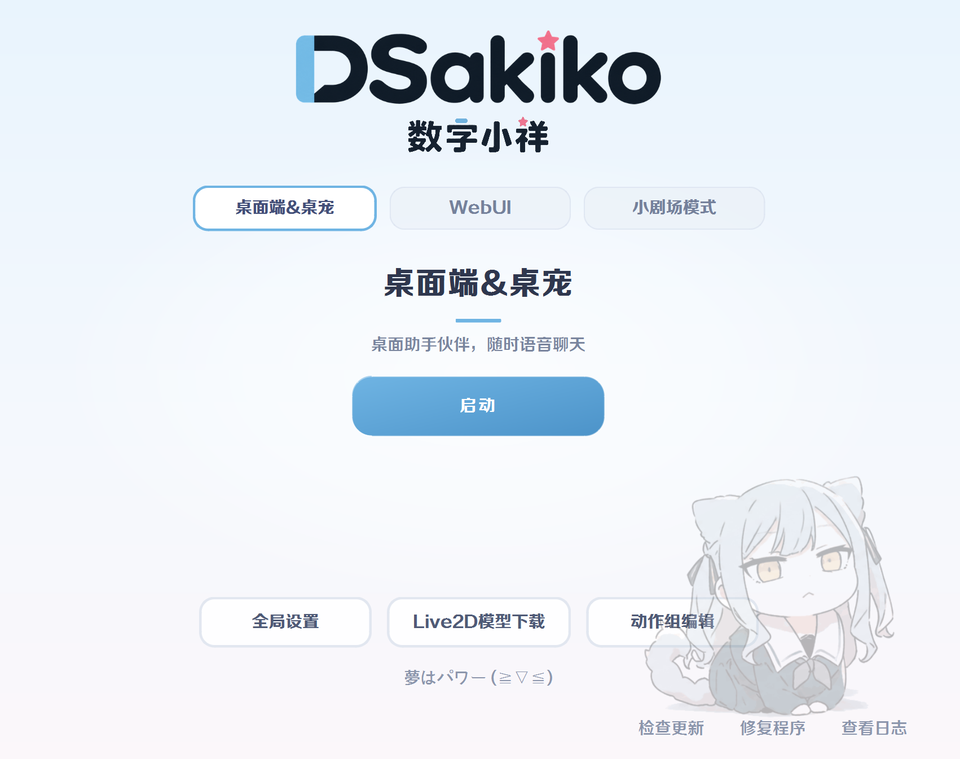
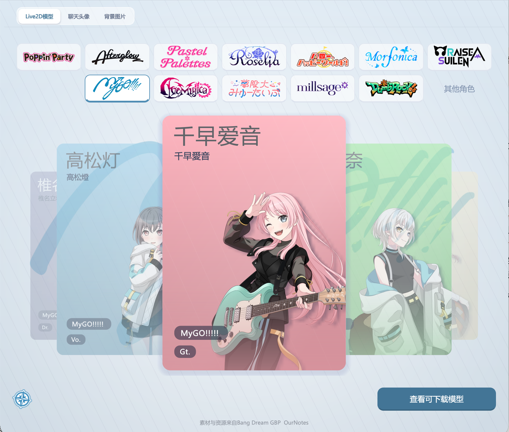
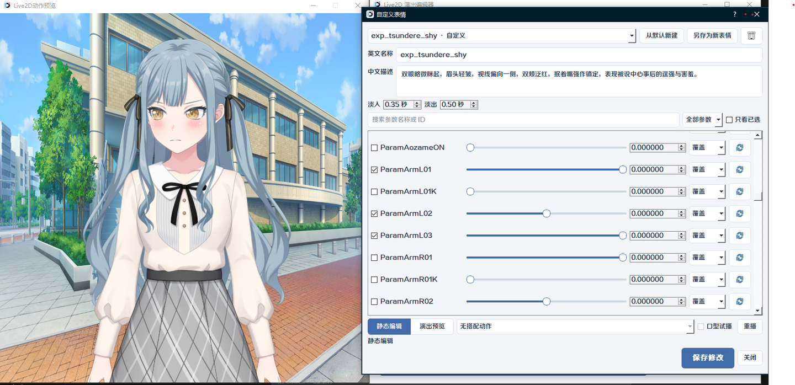
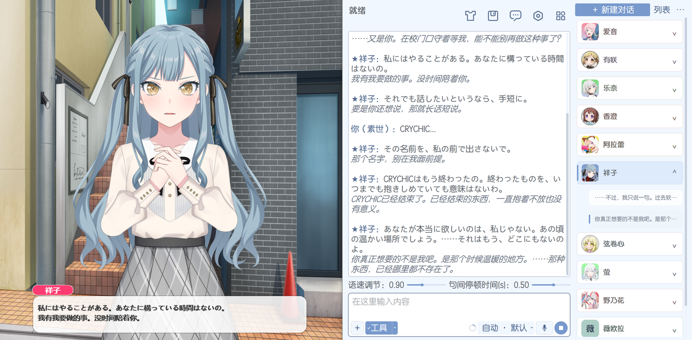
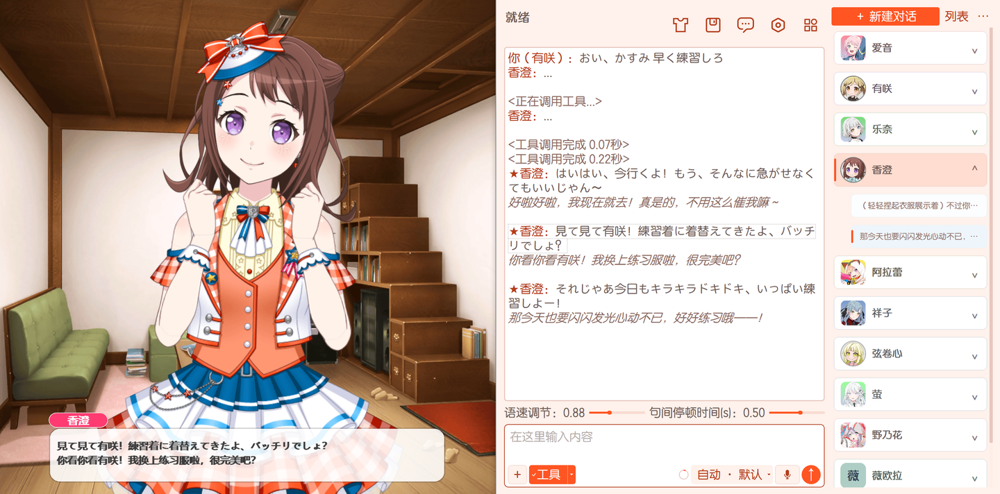
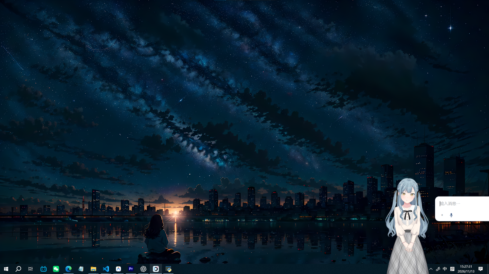
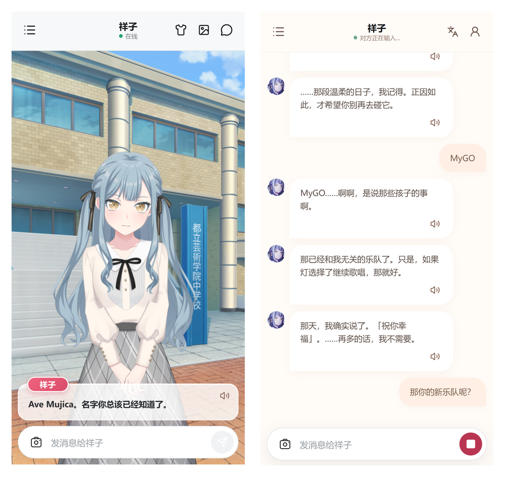
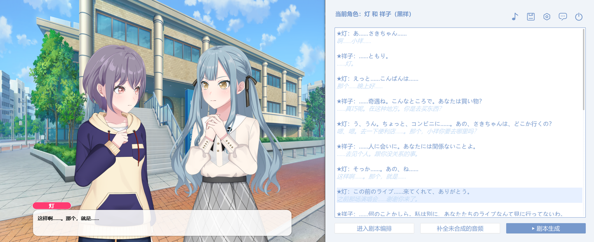
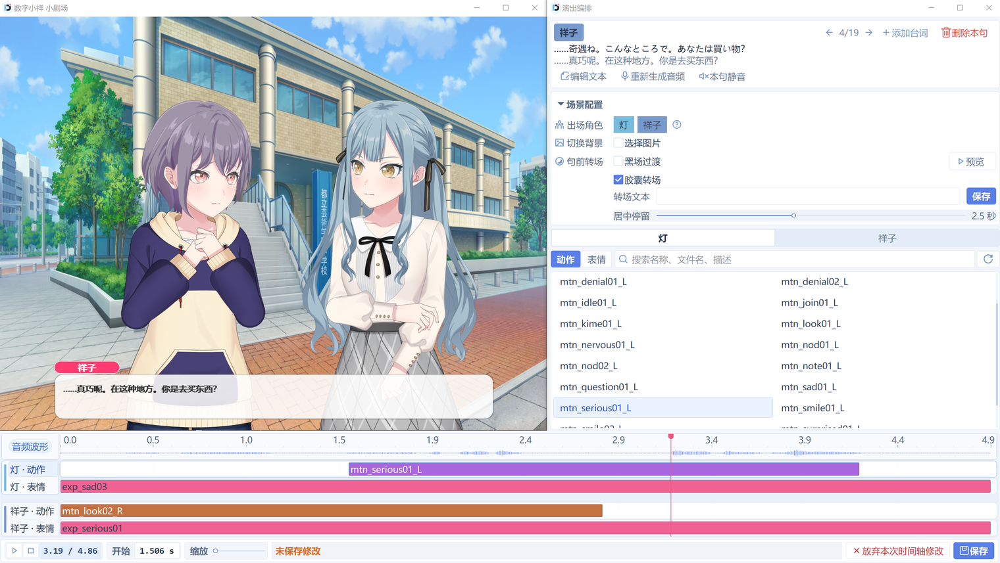

<picture>
  <source media="(prefers-color-scheme: dark)" srcset="./docs/logo_light.png" />
  <source media="(prefers-color-scheme: light)" srcset="./docs/logo.png" />
  
</picture>
 
<!-- <picture>
  <source media="(prefers-color-scheme: dark)" srcset="./docs/logo_zh_light.png" />
  <source media="(prefers-color-scheme: light)" srcset="./launcher/assets/logo_zh.png" />
  
</picture> -->

### 数字小祥 · 多模态桌面/移动端虚拟角色 Agent

**免费开源 · 低门槛开箱即用 · 预置免费 Deepseek API**

[软件包下载](#软件包下载与快速开始) · [核心玩法](#核心玩法) · [功能详解](#功能详解) · [B站介绍视频](https://www.bilibili.com/video/BV1XzSYBBEyf/) · [版本更新记录](#版本更新记录) · [常见问题](#注意事项与常见问题) · [使用文档](https://www.dsakiko.org/)

---

## 项目简介

**DSakiko（数字小祥）** 是一款开源的多模态虚拟角色 Agent 客户端：以 Live2D V2/V3 模型作为形象，GPT-SoVITS 多情绪语音作为声音，大模型与 ReAct 工具调用引擎作为核心，提供**桌面窗口、聊天桌宠、手机 WebUI** 三种使用形态，并附带可用于二创的**双人小剧场**模式。

项目以 **《BanG Dream!》** 角色与世界观为基础，从模型下载、角色表现力、语音合成，到跨端使用以及小剧场模式，提供了一套**开箱即用**的完整生态；同时也支持导入自定义角色与外部 Live2D 模型，可接入任意非邦邦角色。

<table>
  <tr>
    <td width="50%" valign="top">
      <b>资源一键下载</b> 
      覆盖 GBP/OurNotes 全部 12 支乐队角色，Live2D 模型、背景图、聊天头像一键安装。
    </td>
    <td width="50%" valign="top">
      <b>动作表情自由搭配</b> 
      V3 模型的动作与表情相互独立，由大模型按语境实时组合，角色表现更生动；也可在编辑器中拖动 Live2D 模型部件参数，捏出新表情。
    </td>
  </tr>
  <tr>
    <td width="50%" valign="top">
      <b>多情绪语音合成</b> 
       7 种情绪各绑定参考音频，开心、委屈、生气等声线各不相同，角色会根据不同回复内容切换语音情绪。
    </td>
    <td width="50%" valign="top">
      <b>对话与 Agent 能力</b> 
      内置联网搜索、定时提醒、读取/写入本地文件等工具调用，另有识图、对话分叉与备份等功能。支持 DeepSeek、Kimi、Gemini 等主流接口；也能用 ChatGPT 账号登录，使用其 Plus/Pro 订阅额度。
    </td>
  </tr>
  <tr>
    <td width="50%" valign="top">
      <b>桌面与手机跨端</b> 
      桌面窗口、聊天桌宠和 WebUI 共用同一套存档与模型，具有相同的 Agent 能力。WebUI 可用手机扫码直接进入，无需安装任何 APP。
    </td>
    <td width="50%" valign="top">
      <b>双人小剧场二创</b> 
      选定两名角色，然后一键生成剧本与配音。支持角色上下场、面对面、胶囊转场以及基于时间轴的动作表情编排功能，演出效果可接近游戏内的剧情播放器。
    </td>
  </tr>
</table>

> [!TIP]
> **即将上线**：项目即将引入邦邦世界书，内置完整《BanG Dream!》世界观与剧情知识库，进一步增强交互沉浸感~

---

## 核心玩法

### 统一图形启动器
双击 `数字小祥启动器.bat`（macOS 为 `数字小祥启动器.command`），即可进入整合了所有入口的图形启动器：桌面端与桌宠、手机 WebUI、小剧场，以及全局设置、模型下载器、动作组编辑器、在线更新与程序修复。

  
   
  数字小祥启动器

### 资源下载与编辑
- **一键下载**：内置下载器覆盖邦邦全部乐队成员，可一键安装角色模型、额外服装、故事模式背景图与 WebUI 聊天头像，无需手动配置零散文件。
- **动作组编辑器**：V3 模型的动作与表情可以独立搭配，并支持预览效果、为每个动作写说明供大模型理解；也能拖动模型部件的参数滑块，捏出新表情。
- **Live2D 模型兼容**：同时支持 Live2D Cubism V2 与 V3 模型，已有角色和新模型都能使用。也可以导入自己的 Live2D 模型，绑定参考音频与人设，接入任意非邦邦角色。

<table align="center" width="100%">
  <tr>
    <td width="36.35%" align="center" valign="top">
      
       
      资源下载器
    </td>
    <td width="63.65%" align="center" valign="top">
      
       
      动作组编辑器 也有捏表情功能
    </td>
  </tr>
</table>

### 桌面窗口与聊天桌宠
- **桌面窗口**：完整的聊天界面，多情绪语音、历史回放、Agent 能力以及对话分叉与备份等等核心功能。
- **聊天桌宠**：角色常驻桌面，随时可以对话。可从桌面窗口模式一键切换。桌宠同样具备完整的 Agent 与语音能力。

  
   
  桌面端 UI

  
   
  老邦以及其它 Live2D V2 模型也是完全支持的

  
   
  桌宠模式

### 手机端 WebUI
电脑端会先弹出配对二维码（或使用 6 位访问码），同一局域网内的手机、平板扫码即可进入，无需安装 App。提供**聊天模式**和**Live2D 角色模式**两种视图，支持拍照传图、换装、换背景、换头像。

  
   
  手机端可在 Live2D 角色视图与聊天气泡视图之间自由切换。

### 双人小剧场
选定两名角色并填写想要的情境，即可借助大模型生成一段带配音的 Live2D 日常/对手戏，演出效果接近游戏内的剧情播放器：
- **舞台调度**：提供角色上下场、V3 模型面对面、背景切换、黑场与胶囊文字转场、BGM 切换等编排功能，以及无角色的旁白或内心独白。
- **时间轴编排**：编排器以音频时长为基准，能够精细调整两位角色的动作、表情、上下场、背景与转场。
- **播放控制**：支持自动连播、手动逐句推进、从任意一句开播，方便直接观看或录屏。
- **推荐工作流**：可以先让 AI 生成纯文本剧本，再修改台词，一键补齐缺失配音，最后完善演出编排。也可以直接一键生成完整剧本，由大模型同时给出台词、动作表情与场景调度，在此基础上优化。

  
   
  小剧场模式 主界面

  
   
  将动作/表情文件拖动到下方时间轴中即可编排角色演出。也可以在这里配置场景、背景和转场效果。

> [!NOTE]
> 后续还计划加入剧本分享功能，可分享上传自己的作品，也能下载他人的剧本进行观看~

---

## 功能详解

### 1. Live2D 模型与演出
* **Live2D 演出表现**：支持 Bestdori 提供的 V2 模型，同时也支持 OurNotes 的 Live2D V3 模型。V3 模型很细腻，因此设计了**动作与表情相互独立，大模型根据台词语义自由组合**这一方案，同一个动作能搭配不同的神态，大幅提升了角色表现力。实际上项目最开始是基于老邦 V2 模型开发的，当时 OurNotes 可能还没立项...
* **动作组编辑器**：可按左 / 中 / 右方向预览动作与表情的搭配，为每个动作编写自然语言描述供大模型理解，并保存为组合预设。内置**自定义表情制作器**，可调节眼睛、眉毛、嘴角等模型部件的参数滑块，捏出角色的新表情。
* **模型下载器**：覆盖邦邦所有 12 个乐队以及部分有模型的其他角色。可一键下载新角色、新服装、故事模式背景图或 WebUI 聊天头像。
* **渲染与音画同步**：采用自维护的 `live2d-py` C++ 渲染管线，支持 **30 / 60 / 120 FPS** 切换。每句台词的语音、口型动作与逐字字幕会相互等待，三者都完成后才进入下一句，避免音画脱节。
* **祥子黑白双形态**：黑祥与白祥各自有独立的人设、参考音频、默认模型与服装库，切换形态时自动恢复对应服装。

### 2. 语音合成与识别
* **多情绪语音合成**：基于 GPT-SoVITS（支持 V2ProPlus 与 V4），可为 **7 种情绪**分别绑定参考音频与参考文本，合成时自动匹配当前句的情绪。
* **语音输入**：本地 Whisper 模型在独立子进程中运行，点击开始 / 结束录音后，识别结果会填入当前输入框，确认后再发送。
* **自动释放显存**：可关闭语音模型预加载；在桌宠模式或关闭语音后，闲置满 120 秒会自动卸载 TTS 与 ASR 模型，下次对话时再按需加载。

### 3. Agent 能力与对话系统
* **大模型接入**：
  * **默认免费 API**：内置作者提供的免费 Deepseek API，装好即用无需配置；
  * **ChatGPT 账号登录**：通过官方 **Sign in with ChatGPT** (OAuth) 登录，直接使用自己的 ChatGPT Plus / Pro 订阅额度，支持多账号管理与切换；
  * **多接口支持**：同时支持 `Chat Completions` 与 OpenAI `Responses` 两种协议，可接入 DeepSeek（针对 Prompt Cache 做了优化）、OpenAI、Gemini、Anthropic、火山引擎（豆包）、Kimi、**ModelScope（魔搭社区每日免费额度）**及任意自定义接口，并可设置模型输入上下文上限与请求超时。
* **工具调用**：轻量 ReAct 执行流，具备异常自纠错能力。**12 项内置工具**可在设置中整体关闭或逐项勾选，包括读取本地目录与文件、导出文档并打开、联网搜索、切换角色服装等等，以及弹出**桌面大转盘**抽签等。
* **图片识别**：可拖拽或上传多张图片与角色交流，适配 OpenAI 兼容的视觉模型、Responses 协议的内联图片，以及 DeepSeek 官方的文件上传接口。
* **用户身份**：可自定义你的姓名、性格背景与头像，也可以直接选择**扮演软件包内已有的角色**，例如扮演素世与祥子对话。
* **对话管理**：
  * **消息操作**：单条消息可编辑重发、重新生成，也能回溯到指定位置或删除某一轮对话；历史消息支持语音回放，也可切换为纯文本阅读；
  * **对话分叉 (Fork)**：从任意历史消息处分出一条独立的平行对话，保留前文上下文，两条对话互不影响；
  * **备份与导入**：可勾选单条或多条对话（可附带历史语音与图片），导出为 `.dsakiko-chat.zip`，并在其他设备上导入恢复；
  * **上下文压缩**：实时显示上下文 Token 占比，超出阈值后可将早期对话自动压缩为累计摘要，同时保留近期原文。

### 4. 更新与维护
* **在线差分更新**：升级时只下载差分补丁和少量替换文件，不必每次重新下载完整包，也不用自行下载补丁包手动替换文件。
* **程序检查与自修复**：通过 SHA-256 与 Ed25519 数字签名校验，一键检查并仅替换缺失或被改动的官方程序文件，失败时自动回滚；**不会修改任何聊天存档、配置、自定义角色或模型资源**。

---

## 软件包下载与快速开始

> [!IMPORTANT]
> **Windows 路径提醒**：解压后的软件文件夹路径中**不能包含中文或特殊符号**（例如推荐放在 `D:\Apps\D_sakiko`，切勿放在类似 `C:\Users\中文名\Desktop\数字小祥`）。

### Windows 版本（开箱即用）
下载并完整解压后，双击软件包根目录的 **`数字小祥启动器.bat`** 打开图形启动器即可使用，无需额外安装 Python 或配置环境。

* **百度网盘**：https://pan.baidu.com/s/1kLJT0mZ_gGQ2yRUrMJU_Tw?pwd=7vsd （提取码：`7vsd`）
* **天翼云盘（不限速）**：https://cloud.189.cn/t/b2EjU36Nj67b （访问码：`0fe8`）
* **Google Drive**：https://drive.google.com/drive/folders/1jWgKRWXvpRIgyiYpkVgk7vXGMFL-kiyz?usp=sharing

### macOS 版本（支持 Apple M 系列芯片，macOS 14+）
首次使用请先双击运行包内的 `安装程序.command` 自动完成环境配置，随后双击 **`数字小祥启动器.command`** 即可打开图形启动器。详细图文教程与权限放行方法请见：[MacOS 软件包安装指南](./docs/MacOS%20软件包安装指南.md)（感谢 [@yan-xiaoo](https://github.com/yan-xiaoo) 完成 macOS 移植与维护）。

* **4.0.0 版本 - 百度网盘**：https://pan.baidu.com/s/1yZBPyI1Db8aJ5r3IzIr3sA?pwd=1122 （提取码：`1122`）
* **4.0.0 版本 - 天翼云盘**：https://cloud.189.cn/t/FZ7FZvmArqQv （访问码：`r8yi`）
* **Google Drive**：https://drive.google.com/drive/folders/1jWgKRWXvpRIgyiYpkVgk7vXGMFL-kiyz?usp=sharing

---

## 技术栈与主要依赖

本项目集成并改进了以下开源项目与模型：
* **Live2D 渲染**：基于 [live2d-py](https://github.com/Arkueid/live2d-py) 深度定制维护的 C++ 渲染管线（支持 Cubism V2 / V3 与 PyQt5 / Pygame / OpenGL 原生透明窗口）。
* **界面框架**：PyQt5 & QFluentWidgets / FastAPI + WebSocket + React + Vite（移动端 WebUI）。
* **语音合成与识别**：[GPT-SoVITS](https://github.com/RVC-Boss/GPT-SoVITS)（V2ProPlus / V4） & Faster-Whisper（基于 OpenAI Whisper 模型）。
* **情感识别**：基于 [Bert-base-Chinese](https://huggingface.co/google-bert/bert-base-chinese) 结合 [OCEMOTION 数据集](https://aistudio.baidu.com/datasetdetail/100731) 微调的七分类文本情感识别模型。
* **大模型通信层**：统一的大模型调用层，支持 LiteLLM `Chat Completions` 路由、OpenAI `Responses` 协议及原生浏览器 OAuth (`Sign in with ChatGPT`)。

---

## 注意事项与常见问题

1. **硬件配置建议**：语音合成底层依赖 torch，因此建议配备 NVIDIA 独立显卡（显存 6GB 及以上）以获得最好体验；Mac 端支持 Apple Silicon MPS 加速。若无N卡或显存较小，可在设置中调低采样步数，或在聊天框输入 `/v` 关闭语音合成，纯文字聊天流畅运行。
2. **老显卡无声音频问题（16系及更早N卡）**：GTX 1660Ti 及更早架构显卡在开启 `fp16` 半精度推理时可能因底层驱动原因生成无声音频。若遇到有字幕但无声音的情况，请在全局设置中将推理精度切换为 `fp32`（单精度）。
3. **程序损坏或更新失败怎么办？**：无需重下完整包，直接打开 `数字小祥启动器`，点击 **「修复程序」** 即可自动校验并替换异常文件。
4. **WebUI 安全提示**：手机端 WebUI 使用局域网连接，本身有登录鉴权设计，但还是建议仅在家庭/学校 Wi-Fi 或个人热点等可信局域网内使用，不要将端口直接暴露至公网。

---

## 版本更新记录

### v4.0.0 ~ v4.1.0
* **新增原生透明桌宠形态**：角色可直接驻留桌面，支持文字/语音对话、轮廓外鼠标穿透、滚轮缩放、非抢焦点交互，以及闲置 120 秒自动卸载语音/识别模型节省显存。
* **新增统一图形启动器 & 全新品牌 Logo**：将桌面端、WebUI、小剧场、模型下载器、动作组编辑器、参数配置、在线更新与程序修复全部整合至统一启动器，实装全新的中英文与方形图标 Logo。
* **Live2D 模型下载器 V2 重构**：接入自维护托管源，新增支持 OurNotes 高精度 V3 模型（含 **夢限大MewType、millsage、一家Dumb Rock!** 等 13 个分类），支持一键下载角色模型、额外服装、故事模式背景图与 WebUI 聊天头像。
* **V3 动作与表情解耦系统 & 全新编辑器**：V3 模型支持动作与表情双通道独立选择与自由搭配；重写动作组编辑器，支持方向预览、组合预设管理，并内置**自定义表情参数制作器**。
* **小剧场演出编排器与交互大升级**：新增多轨时间轴演出编排模式，支持**角色上下场、中途切换背景、黑场转场、无角色旁白、未发言角色姿态延续与面对面动作**；支持“先生成纯文本剧本、修改后再一键批量补齐配音”、插入/删除/修改台词，支持自动连播/手动逐句推进/从指定句播放，以及原文/译文/双语字幕模式切换。
* **支持 OpenAI Responses 协议 & Sign in with ChatGPT**：支持任意兼容 Responses 协议的服务端，并支持通过官方 OAuth 登录直接使用 ChatGPT 订阅账号额度对话；支持自定义模型输入上下文上限与分类请求超时设置。
* **祥子黑白形态与面具能力升级**：黑祥与白祥各自拥有独立默认模型与可选服装目录，切换形态自动恢复对应服装；新增面具动作绑定编辑器。
* **回放体验与反馈机制**：历史消息回放支持随时打断与纯文本阅读回放；支持逐个开关 Agent 工具；新增应用内点赞/点踩与意见反馈机制。

### v3.5.0 (2026.09) — 移动端 WebUI、对话分叉备份、上下文压缩与程序自修复
* **全新移动端/局域网 WebUI**：支持手机/平板扫码一次性配对或 6 位访问码登录，提供聊天视图与全屏 Live2D 角色视图切换、手机端拍照/传图、换装换头像与实时口型同步。
* **对话复制、平行分叉 (Fork) 与备份导出**：支持从任意历史消息处分叉出独立新对话；支持勾选多条对话（含历史语音与图片附件）导出为 `.dsakiko-chat.zip` 并在任意设备导入恢复。
* **程序文件检查与自修复**：基于数字签名校验并仅替换缺失或损坏的官方小型程序文件，支持失败回滚，不触碰用户存档与模型。
* **实验性滚动上下文压缩**：根据 Token 用量阈值自动将早期记录浓缩为累计摘要并保留近期原文。
* **角色解耦**：支持创建无 Live2D 或无语音模型的纯文字角色，首次导入模型自动晋升为默认模型。

### v3.2.0 (2026.07) — Live2D V3 支持与多情绪参考音频
* **全面支持 Live2D Cubism V3 模型**：主界面、小剧场、动作编辑器全面适配 `.model3.json` V3 模型，支持外部模型自包含导入与各场景独立缩放/位移保存。
* **多情绪参考音频**：支持按 7 种情绪（喜/怒/哀/惧/惊/厌/好）分别配置参考音频与参考文本，合成时自动匹配对应情绪语气。
* **新增预加载与工具开关**：支持关闭语音模型预加载以节省显存；支持对话级关闭工具调用。

### v3.1.0 ~ v3.1.1 (2026.06) — 多模态识图、用户人设与历史精修
* **支持多模态图片上传**：支持发送图片与视觉大模型交流（含 DeepSeek 多模态适配）。
* **支持用户对话身份 (User Persona)**：可自定义用户人设，或直接选择扮演软件包内的已有角色。
* **细化历史消息操作**：支持单条消息编辑并重发、回溯对话至指定位置、删除整轮对话、查看当前上下文 Token 占用圆环、自定义小剧场 BGM 及语音模型预加载机制。

### v3.0.1 ~ v3.0.3 (2026.05) — 渲染管线升级与输出契约强化
* **Live2D C++ 渲染管线与高刷**：升级 `live2d-py` v2cpp C++ 渲染管线，支持 **30 / 60 / 120 FPS** 帧率切换；支持 GPT-SoVITS CUDA Graph 加速。
* **输出格式稳定性与缓存优化**：引入 JSON Mode + 严格 Schema 校验 + 失败反馈重试机制，显著减少大模型输出格式错误；重构 System Prompt 结构以提升 DeepSeek 服务端缓存命中率。

<b>点击展开 v2.0 ~ v2.6.5 早期版本更新记录</b>

### 2026.2.17 v2.6.5
* 新增初版 Live2D 模型下载器（Bestdori 服装扩展与一键添加新角色）。
* 小剧场模式底层重构与列表流 UI 升级，完善对话增删改功能。
* 动作组编辑程序重构，支持同角色不同服装独立编辑动作组。

### 2026.1.16 v2.6
* **macOS 版本正式发布**（由 [@yan-xiaoo](https://github.com/yan-xiaoo) 完成移植适配与 QFluentWidgets 界面重构）。
* Windows 版界面现代化换新，支持邦邦角色预设主题色一键切换、参考音频与 API 配置实时生效、新增魔搭社区 (ModelScope) 免费 API 额度支持。
* 升级支持 GPT-SoVITS V2ProPlus，大幅提升推理速度与音质。

### 2025.12.29 v2.5
* **双人小剧场模式正式上线**（详情视频：[BV1LHviBmEkT](https://www.bilibili.com/video/BV1LHviBmEkT/)）。

### 2025.12.9 v2.4
* 新增图形化启动参数配置程序（支持调节 fp16/采样步数、配置 API、调整角色登场顺序、更换字体）。

### 2025.11.10 v2.3
* 新增麦克风语音识别 (ASR)、初版动作组编辑器、语速与句间停顿调节、OpenAI/Gemini API 支持，升级 PyTorch 支持 RTX 50 系显卡。

### 2025.6 v2.0 ~ v2.2
* 升级 GPT-SoVITS V4 模型、推出多角色自定义模式、日语同步中文翻译、黑祥 Mujica 礼服切换、子进程音频推理加速、聊天记录保存与点击历史文本回放音频。

---

## 社区与支持

* **项目作者**：抹茶星冰奈（[B站主页](https://space.bilibili.com/443409863)）
* **核心贡献者**：非常感谢 [@yan-xiaoo](https://github.com/yan-xiaoo) 在 macOS 移植、V2.6.5+ 架构重构及多个核心模块开发上的巨大付出！感谢 [@鸢尾画铃兰](https://github.com/a1229882170) 编写社区教程，以及交流群内所有参与测试与反馈的伙伴。
* **QQ 交流群**：`1026822753`
* **爱发电赞助**：https://afdian.com/a/MacchaPafe

> **版权声明**：本项目代码开源免费，仅供个人学习与技术交流，禁止用于任何商业用途。项目中涉及的《BanG Dream!》相关角色设定、Live2D 模型及音频素材版权均归 Bushiroad、Craft Egg、OurNotes 等原权利方所有。
