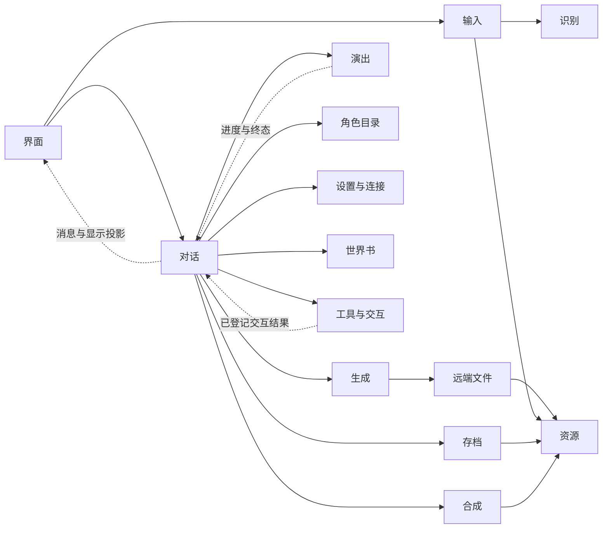

# 核心模块接口契约

更新日期：2026-10-13。正式后端已开始按这些契约实现，主要业务代码位于原接口文件中；装配、HTTP/WebSocket、前端封装和实际覆盖范围见[后端首批实现](backend-implementation.md)。文档仍优先于旧快速原型，未接入的独立适配器保留契约，不以旧原型测试代替验收。

Performance 已拆为[后端计划调度](../src/backend/performance/interface.js)与[前端本地播放](../src/renderer/src/performance/interface.js)。后端推进所有 sequence，不区分前后台，不等待播放反馈；各客户端独立选择展示、计算逐字进度、调节本地音量及回放。

## 阅读顺序

| 模块                    | 接口文件                                                                 | 对外负责                                                                       | 不接收或不承担                                   |
| ----------------------- | ------------------------------------------------------------------------ | ------------------------------------------------------------------------------ | ------------------------------------------------ |
| 对话 `Conversations`    | [conversation/interface.js](../src/backend/conversation/interface.js)    | 接收用户意图，管理多个 Chat，编排生成、存档、合成和演出                        | 动作计时、推理池、模型实例、连接细节             |
| 生成 `Agent`            | [llm/interface.js](../src/backend/llm/interface.js)                      | 基于一次请求完成模型与工具循环，交付保留分组的响应、工具结果，检查上下文与压缩 | 完整可修改 Chat、前后台、TTS、sequence、消息落盘 |
| 后端 `Performance`      | [performance/interface.js](../src/backend/performance/interface.js)      | 场景、sequence、计划时钟与 guide 终态                                          | Chat、Turn、客户端实际播放进度                   |
| 客户端 `Performance`    | [performance/interface.js](../src/renderer/src/performance/interface.js) | 从动播放、本地音量、回放与输出适配                                             | 对话受理和其他客户端进度                         |
| 合成 `Speech`           | [speech/interface.js](../src/backend/speech/interface.js)                | 转换输入和结果，提交、查询、控制并等待 Python 合成任务                         | 调度队列、模型实例、对话归属、失败展示策略       |
| 识别 `Recognition`      | [recognition/interface.js](../src/backend/recognition/interface.js)      | 将录音转换成文本，管理识别模型                                                 | 麦克风录制、草稿、光标、自动发送                 |
| 存档 `ChatStore`        | [storage/interface.js](../src/backend/storage/interface.js)              | 版本校验、原子持久化、迁移、归档                                               | 历史裁剪规则、运行任务、演出进度                 |
| 角色 `CharacterCatalog` | [characters/interface.js](../src/backend/characters/interface.js)        | 角色与对话身份定义的存取、身份与能力解析                                       | 当前 Chat、自动替换已有快照、模型加载与推理      |
| 资源 `MediaAssets`      | [resources/interface.js](../src/backend/resources/interface.js)          | 文件导入、访问寻址、引用和回收                                                 | 对话业务、文件应在哪一句播放、历史删除决策       |
| 远端文件 `RemoteFiles`  | [remote-files/interface.js](../src/backend/remote-files/interface.js)    | 厂商文件上传复用、引用失效、显式删除与自动回收                                 | Chat、输入框状态、生成流程重试、任意账号文件管理 |
| 输入 `InputSessions`    | [input-sessions.js](../src/renderer/src/features/chat/input-sessions.js) | 每个对话的草稿、录音、附件和识别文本插入                                       | Agent、历史修改、TTS、演出                       |

新增后端模块同样只提供声明：

| 模块                                        | 接口文件                                                                                 | 职责                                                                     |
| ------------------------------------------- | ---------------------------------------------------------------------------------------- | ------------------------------------------------------------------------ |
| Settings                                    | [settings/interface.js](../src/backend/settings/interface.js)                            | 类型化设置、连接、能力来源与受控凭据写入                                 |
| ToolCatalog / Interactions / ReminderWriter | [tools/interface.js](../src/backend/tools/interface.js)                                  | 依赖与授权、可靠交互、仅工具可用的提醒创建                               |
| Worldbook                                   | [worldbook/interface.js](../src/backend/worldbook/interface.js)                          | 固定知识范围、受限查询与独立诊断，本次不实际检索                         |
| Conversation 内部查询绑定                   | [worldbook-query-interface.js](../src/backend/conversation/worldbook-query-interface.js) | 直接上下文与工具共用查询，统一关联来源、校验资格和接收诊断，不公开到 IPC |
| PythonChatImporter                          | [python-import-interface.js](../src/backend/storage/python-import-interface.js)          | 旧 Python 一次性有损转换                                                 |
| Live2dImporter                              | [live2d-import/interface.js](../src/backend/live2d-import/interface.js)                  | V2/V3 完整依赖包与原子发布                                               |

共享数据集中在以下文件，避免调用方依赖模块内部类：

- [common.js](../src/shared/contracts/common.js)：资源引用、持有者编号、问题、元数据与取消订阅函数。
- [conversation.js](../src/shared/contracts/conversation.js)：嵌套历史、句级定位、输入来源、运行与保存状态。
- [message-projections.js](../src/shared/contracts/message-projections.js)：只读台词、reasoning、调用、结果与展示 helper 声明。
- [settings.js](../src/shared/contracts/settings.js)、[models.js](../src/shared/contracts/models.js)：配置分组、执行覆盖、连接与能力来源。
- [characters.js](../src/shared/contracts/characters.js)：forms、默认模型指针及声音选择。
- [tools.js](../src/shared/contracts/tools.js)、[worldbook.js](../src/shared/contracts/worldbook.js)、[archive.js](../src/shared/contracts/archive.js)：交互关联、知识范围与恢复警告。
- [presentation.js](../src/shared/contracts/presentation.js)：场景、逻辑演出选择、模型状态映射与快照、guide、进度、终态及回放材料，不含客户端音量。
- [speech.js](../src/shared/contracts/speech.js)：声音配置、合成请求、任务编号与结果。
- [persona.js](../src/shared/contracts/persona.js)：可复用的对话身份定义、选择摘要与 Chat 固定的身份快照。

Python 合成调度的接口原型见 [speech/interface.py](../python/speech/interface.py)，输入和结果见 [speech/contracts.py](../python/speech/contracts.py)，调度规则与 HTTP 映射见 [语音调度接口设计](../python/speech/README.md)。Python 的接口只描述合成任务，不依赖 JavaScript 的业务对象。

前端专用的 [playback-contracts.js](../src/renderer/src/performance/playback-contracts.js) 保存 PlaybackOptions 声明；它不属于共享网络报文或后端 Settings。

## 调用关系



界面取得 `PreparedSubmission` 后调用对话接口，受理成功再确认清理草稿。生成模块按响应身份交付有序内容，包含完整校验的台词；对话模块构造嵌套消息、创建 guides、提交合成，按稳定句身份关联结果。合成成功则提交音频并放行 guide，失败则按业务策略无语音放行。演出模块始终独立推进，只有需要时才订阅或等待完成。

对话模块可将演出进度映射为消息显示投影，但不重新计算演出时间。其他只关心演出的界面也可以直接观察演出模块。

`Chat` 是可持久化的数据，`Conversation` 是持有并推进它的运行对象；`Conversations` 模块管理这些运行对象，`ChatStore` 只负责数据持久化。一个 Chat 只有一个运行时修改所有者，同一 Chat 的修改和保存有序执行。

`ChatStore.save(snapshot)` 使用 `snapshot.revision` 核对当前存档版本，调用方不预先递增，也不重复提供预期版本参数。版本比较与写入原子完成；成功后 Store 递增一次并返回独立的新 Chat 快照，不修改输入对象。Conversation 采用返回快照作为后续修改的基础。`delete(chatId, expectedRevision)` 不携带快照，因此仍显式提供预期版本。版本校验防止意外覆盖，不代替访问权限检查、业务串行化或迟到结果判断；冲突后不能把旧内容的版本号改大再强行保存。

新 Chat 的 `revision` 为 0，只有该 ID 尚不存在时才能首次保存为版本 1。分支和归档导入分配新身份后，也从 0 开始。每次成功提交存档写入递增一次，未成功提交不递增；它不是消息数量，也不随播放进度变化，与运行态的 `ConversationSnapshot.revision` 及存档格式版本分别管理。

## 角色目录与对话身份

`CharacterDefinition` 使用非空 `forms` 与 `defaultFormId`，每个形态含名称、描述、头像、主题色、声音、`models` 和 `defaultModelId`。产品明确每个模型配置只属于一个形态，因此模型登记在 `CharacterForm.models` 下，不再保留角色级 `models` 或模型的 `formIds`。模型 ID 在同一角色内唯一；默认指针必须指向本形态的一项，无模型时为 null。不同模型配置仍可引用相同底层资源包，配置归属不要求复制资源或改变包内目录。

Chat 保存当前 formId 及各形态模型覆盖，覆盖值必须属于对应形态；换装不改变形态或目录默认值，切回形态时沿用该形态的模型覆盖。`Live2dImporter` 只产生尚未登记的模型配置和资源，调用方将其放入目标形态后交目录保存。迁移旧平级配置时按形态归入 models；旧配置被多个形态引用时，拆成各形态独立且 ID 不同的配置，修正默认指针和 Chat 覆盖，底层资源可复用。

`CharacterDefinition` 保存用户配置，包括当前不可用资源的原引用；`CharacterCapabilities` 是从配置与资源元数据派生的一次能力快照，提供逻辑动作、表情目录和问题说明。解析不会把临时不可用的能力写回配置，也不代表已经实际加载模型。演出与语音模块仍负责实际加载和运行时故障处理。这两个结构都是普通数据对象，转换由目录实现，JSDoc 不会自动裁剪或转换字段。

Node 中的 `CharacterCatalog` 是唯一的权威目录。通过目录保存角色后，后续 `list`、`get` 和相关解析即可看到新配置；目录维护自己的缓存及资源依赖失效，页面按需重新查询。Python 与演出模块只接收执行所需材料，不分别维护全量角色列表。新角色登记后即可创建 Chat，不要求应用重启；本轮不提供向已有 Chat 添加参与角色的操作。直接修改外部文件的发现方式属于目录内部接入设计，本轮不增加公开重新扫描方法。

对话身份定义由同一个目录模块持久化在 `<用户数据目录>/personas/<personaId>.json`，文件名使用稳定 ID，不随名称改变。`listPersonas` 返回当前选择摘要，`getPersona` 返回可编辑的原始定义，`savePersona` 保存定义并递增自身版本，`resolvePersona` 解析当前实际名称、描述和头像。定义的 revision 表示它本身的版本；关联角色更新不递增这个版本，但后续解析必须采用角色的新配置，不能只用 persona 的 revision 缓存解析结果。

`UserPersonaDefinition.source` 有两种互斥形式：`custom` 保存 `displayName`、`description` 与可选 `avatar`；`character` 只保存 `characterId`，不在绑定时复制角色文本或头像。角色引用失效时仍能读取定义以修复，也会出现在带问题说明的选择列表中；解析时则明确拒绝，不使用过期文本或默认人格掩盖问题。

普通新建通过 `createChat({ ..., userPersonaId })` 选择身份，省略或 null 表示无自定义人格。Conversation 在创建时调用 `resolvePersona`，将实际采用的完整身份快照保存到 `Chat.userPersona`。关联角色当时默认形态的名称和描述被固定下来；角色缺失时创建失败。目录只负责解析数据，不负责何时创建 Chat，也不解析用户身份的模型、语音或动作能力。

例如，角色描述为 A 时创建的 Chat 保留 A；角色描述改为 B 后，新建的 Chat 获得 B。继续已有 Chat、重新生成、分支和归档导入都沿用已固定的身份，不重新解析当前目录；自定义人格修改也只影响后续普通新建。身份快照的来源编号只用于记录出处，不要求导入环境存在原始人格或角色。快照头像由 Chat 持有资源引用并随归档携带；旧存档没有任何身份信息时才使用 null，不能从当前目录补造历史身份。

每次 Agent 请求的 `userPersona` 只从 `Chat.userPersona` 提取名称与描述，不传完整定义、头像或来源编号，也不加入 `characters` 中允许 Agent 生成台词的角色。人格定义编辑、选择列表预览和 Chat 身份固定是不同操作，预览不能提前决定之后创建 Chat 时使用哪份文本。

## 版本信息的使用范围

`Settings.get()` 返回完整设置快照；`get(path)` 按与 `set` 相同的配置项路径返回独立的值副本，未设置的可选项返回 undefined，未知路径或分组路径报错。读取不写盘，也不递增版本。

`Settings.set(path, value, options)` 修改一个点分隔路径的配置项并立即保存；`Settings.update(patch, options)` 批量更新提供的字段，配置分组递归合并，`speech.sampling` 和资源引用等原子项整体替换。两者返回实际保存的完整设置快照。`options.expectedRevision` 用于基于已有快照的编辑，冲突时整批拒绝；省略时，增量按队列顺序应用于最新设置。每次成功调用递增一次 revision，调用方不能通过 patch 修改 revision。

默认值和字段规则统一声明在 `backend/settings/definition.js`，配置项提供 `validate()` 与 `correct()`。`set/update` 默认拒绝非法输入，只有显式传入 `{ correct: true }` 才尝试修复，修复后仍须通过校验。数值项可舍入整数、截断闭区间，但不转换字符串；布尔和枚举项可回退默认值。未知字段和非法资源引用不会被静默删除。新值在入队前校验并复制，整批合法后才进入版本检查、资源引用提交、持久化和通知流程。

读取文件时只补齐缺失且声明了默认值的字段，不自动写回，不修复显式非法值，也不覆盖损坏文件。对话和单轮覆盖复用同一份字段规则但不补默认值，保留“省略表示继承”的含义。

版本只在调用方确实需要提供“基于哪份数据修改”或接收方需要识别迟到快照时公开，不作为所有方法的通用参数。`ChatStore.save(snapshot)`、`CharacterCatalog.save(definition)` 和 `savePersona(definition)` 都从输入对象读取原 revision，由持有数据的模块原子校验并递增，返回新快照；新建使用 0，首次保存为 1，调用方不另传 expectedRevision，也不自己计算新版本。

`ChatStore.delete(chatId, expectedRevision)` 保留预期版本：删除请求只有 ID，没有携带快照；模块自己的最新版本不能表达调用方原本看到哪个版本。`ConversationSnapshot.revision` 和 `SequenceSnapshot.revision` 用于观察更新的排序，`CharacterCapabilities.revision` 标记所采用的配置版本，都不要求业务调用方递增或回传。

`InputSessions` 是同一前端实例内管理当前草稿的模块。`updateDraft(chatId, content)` 同步应用当前输入事件，不接收版本；每份草稿只有一个当前编辑入口，界面不能延迟回写旧文本副本。录音、识别、附件导入和发送确认所需的变化记录由模块内部持有，`InputSnapshot` 不再暴露 revision，`PreparedSubmission` 也不暴露 draftRevision。

识别结束时，输入模块核对录音开始时绑定的草稿状态：文本与选择区域未变才自动插入，否则留下候选。`acceptTranscript(chatId, suggestionId)` 同步在当前选择区域插入，`discardTranscript(chatId, suggestionId)` 明确丢弃；不使用 null 版本号表达丢弃，也不增加让调用方查询内部版本的方法。

`prepareSubmission` 在内部将稳定发送 ID 绑定到草稿内容及变化记录。`acknowledgeSubmission` 只接收 chatId 和这个 ID，确认期间内容未改才清理；新文本或附件受到保护，仅移动光标不视为新的发送内容。实际清理同时使旧录音、识别与导入记录失效，防止迟到结果重新填回已发送草稿。内容未改的重试复用发送 ID，确认清理后再次输入相同文本则产生新意图。这些校验不能因删除公开版本字段而取消，也不能把迟到的异步文本结果当作普通用户编辑回写。

## 消息与生成输入

权威历史为 `Chat → Turn → Message`。Message 有四种：

- `UserMessage`：source 区分 manual、async、reminder；async 保留请求、来源 Turn/call、原问题及实际结果的有序结构。
- `AssistantMessage`：一次模型响应一个容器，parts 按原顺序保存 reasoning、tool-call、dialogue；dialogue 内为有稳定 ID 的 CharacterLine。
- `ToolResultMessage`：用 assistantMessageId/callId 关联调用，结果只存一份；区分成功空值、accepted、失败和运行器中断。
- `AbstractMessage`：累计摘要，位于所覆盖最后完整 Turn 的消息末尾。位置表达范围，不重复保存覆盖终点、父摘要 ID 或定位表。

`Turn.input` 只定位本轮 UserMessage 或标记 scenario；移除重复表达来源的 trigger。无用户文本的主动情景生成使用 `generateScenario`，不走草稿、不伪造用户消息。小剧场只生成一次、之后只重生成的产品限制留在前端，后端不按模式封死连续输入。

Agent 的 `onResponse` 用稳定 responseId 追加尚未接受的 parts：可先交付实际 reasoning/调用，再接受通过校验的台词，仍属于同一容器。工具结果走 `onToolResult`。全部通知顺序等待接受，最终台词也从这里交付；run 只返回 Loop 终态与 usage，避免回调和返回值各复制一份最终回复。格式修复产生的新模型响应另建容器；失败原文只留诊断。

工具仅保留 sync 和 async，按调用列表串行：sync 等后端完成，async 等可靠 accepted。sync 内部可使用 Promise，但不等待前端交互；抽签、问答等需要前端参与的工具统一 async，受理不依赖展示端在线或用户回答。所有工具统一记录，删除 visibility/隐藏分支。async 后续成功结果进入后续 Turn 的 UserMessage，原 accepted 不回写第二份 ToolResultMessage，也不继续原 Loop。InteractionRequest 不再携带执行模式，全部按 async 处理；出现确实需要同轮等待前端的具体需求前不增加第三种模式。中断恢复对缺失结果使用通用 runner/interrupted 结果，不重新执行工具；具体 not_executed/cancelled/outcome_unknown 分类仍是建议，不作为必填枚举。

只读投影 helper 保留原身份与顺序，不产生第二份可写历史。句级操作改用 `LineRef`，不能把一个 assistant 响应当成一条台词。ContextTurn 保留完整轮次裁剪边界，ContextMessage 保留分组、reasoning 类别、协议必要材料和调用关联；协议附加字段只保存必要脱敏内容，不能据此承诺所有供应商报文可无损重放。

上下文只投影最后有效摘要与其后文，system/情景等本次材料正常构造；原始历史保留。只压缩已结束的完整 Turn，至少保留最后一轮，失败保留旧有效摘要。原地编辑保留后文但删除依赖它的后方摘要；截断/分支按位置处理。上下文查询与实际准备共用规则，计入角色、人格、提示、工具、Schema、附件及本次输入，区分估计、未知和实际 usage；查询不压缩、不上传、不执行工具。

## 客户端本地播放音量

每个客户端在前端持久化 `PlaybackOptions { volume, bgmVolume }`。两个值均为有限值，范围 `[0, 1]`，本地值缺失、无效或被清除后对应字段使用 1（100%）。volume 为总音量，bgmVolume 为 BGM 相对音量；第一版不增加 muted 或上次音量，volume 为 0 即静音。它们不属于 Settings、SpeechOptions、Chat、Turn 或 guide，不参与生成时的设置冻结。

`Performance.getPlaybackOptions()` 读取本地偏好，`setPlaybackOptions(options)` 在前端保存并即时应用，不发送后端命令。启动及展示端重建读取本端最新值，本地保存和交接按顺序处理，迟到读取不能覆盖更新后的值；保存失败显式报告，不伪装已经持久化。同一 Electron 客户端的普通窗口与桌宠共用本地偏好；独立浏览器或设备互不覆盖。客户端按自己的前端存储空间管理偏好，不按 Chat 保存。

`GlobalSettings.playback` 与 `BgmSettings.volume` 不属于当前配置，不提供旧字段迁移。BGM 的曲目、开关与循环仍属于原共享配置，实际输出音量只在客户端计算。

| 内容                                    | 音量规则                                                |
| --------------------------------------- | ------------------------------------------------------- |
| 本端正在播放的台词                      | 使用本客户端 volume，当前句立即生效，后续句沿用。       |
| 本端 BGM                                | 使用 volume × bgmVolume，曲目开关与本地暂停仍独立生效。 |
| 本端未播放的 sequence、显式 silent 回放 | 继续无声，提高本地音量不能使其发声。                    |

总音量为 0 时只关闭本端声音输出，字幕、动作和口型照常推进，不重播、不补合成、不改写历史音频，也不影响后端计划时间线与 Turn 完成。silent 由客户端用于本次回放，不修改材料或持久音量。普通模式与桌宠交接不能恢复旧窗口的音量。自动语音开关仍控制本轮是否合成，下轮生效。

## 停止与本地回放

停止时由后端原子保留其计划时间线中的当前普通 guide，并移除本轮后续 guide。Turn 立即 terminated，所属组未消费 async 结果失效，但只要保留句尚未逻辑结束，`admission.canGenerate` 仍为 false。没有当前句时不增加等待；该句逻辑结束或已被显式删除/替换移除后，这项门禁解除，保存故障和压缩等其他限制仍独立生效。`stopTurn` 返回表示停止指令已生效，不承诺下一轮立即可受理；不等待任何客户端实际播完或上报。

后端 `Conversations.getReplayMaterials(chatId, target)` 只读取单句或整轮已保存的场景和台词，返回 `ReplayMaterials`。前端调用 `Performance.replay(materials, { silent })` 独立播放，不创建后端 sequence、不重新生成或合成、不使历史 Turn running，也不反向修改实时演出进度。

后端不持有客户端当前选中的 Chat：删除 `Conversations.selectConversation` 和 `ConversationSnapshot.selected`。页面选择与回放状态由本客户端管理，不能通过选择聊天使其他客户端退出回放。

其他客户端发起的新轮、提醒或 async 自动新轮只提示有新内容，不打断本端回放。用户主动退出，或本端手动新轮确认受理后，调用 `Performance.resumeLive()` 结束本端回放并跟随最新快照；被拒绝或受理结果尚未确认时保留回放。只使本地旧加载和播放回调失效，不关闭后端常驻 sequence、不取消其他客户端回放，也不终止来源 Turn。

## 世界书查询与诊断交接

Worldbook 只接收 `scope/query/signal`，返回 `WorldbookQueryResult { evidence, trace }`。evidence 是允许使用的知识；trace 只保存过滤原因、返回知识的 token 估值和失败信息。请求预算已在 query 中，不重复维护；trace 不再保存阶段、Turn 身份或另一份 selected。可预期查询失败返回空 evidence 与 trace.problem，合法的空结果则 problem 为 null；参数/范围错误按 Problem 拒绝，取消按 AbortError 拒绝。

Conversation 使用内部声明 `bindWorldbookQuery(worldbook, options)` 创建本轮查询函数。options 绑定 TurnId、固定 scope、执行有效期 signal 和唯一的 `acceptDiagnostic` 接收函数。查询函数接收 query、可信 origin 和本次 signal，直接上下文与世界书工具共用同一条查询及记录路径，不为诊断再执行一次检索。

| 调用路径       | 传入的 origin                                           | 存档中的 source                                                                          |
| -------------- | ------------------------------------------------------- | ---------------------------------------------------------------------------------------- |
| 直接上下文准备 | `{ kind: 'direct-context' }`                            | 相同的来源标记。                                                                         |
| 世界书工具包装 | `{ kind: 'tool-query', context: ToolExecutionContext }` | `{ kind: 'tool-query', assistantMessageId, callId }`；先核对 context.turnId 与本轮一致。 |

origin 由 Conversation 或已登记的工具包装构造，不进入模型可填写的参数 Schema。绑定函数检查 enabled 及 directContext/queryTools 开关；接收器还核对调用确实属于当前 Turn。本轮修改设置不替换当前绑定；下一次生成及重生成按当时设置建立新绑定。

每次实际查询只组合一份 `WorldbookDiagnostic { source, query, result }`，其中 result 就是该次 Worldbook 返回值。绑定函数 await 接收后仅返回 evidence。工具包装将知识或普通失败转换为 ToolOutcome，继续使用 Agent 原有 onToolResult；不扩展 GenerationObserver，不经工具结果传诊断，不让 Worldbook 或工具直接修改 Turn.meta。

`ToolCatalog.resolve(chatId, selection, access, queryWorldbook)` 接收这个本轮窄能力。Conversation 仅在 queryTools 启用时传入函数，否则传 null；目录据此注入世界书工具，普通工具 selection 不替代世界书开关。工具调用必须使用 tool-query 来源，不能伪装成直接上下文。

受理前的直接上下文诊断只暂存在当前准备操作中，受理成功后随新 Turn 保存并继续使用同一绑定；校验或初始保存失败时丢弃暂存，不建立空 Turn，也不提前启动工具。受理后的接收器串行核对执行有效性，再追加到当前内存；保存故障按原约定由 retrySave 处理。准备被放弃、生成结束或执行失效时取消绑定信号，旧查询不能继续服务下一轮。长检索不持有 Chat 修改锁，停止与诊断提交仍能有序协调。

可预期检索失败先记录同次诊断，再向调用者报告 Problem；意外异常先脱敏。取消或接收返回 stale 时，不向旧执行交付成功，也不补写新的失败诊断。诊断接收本身失败不能被当作第二次检索失败再次记录；不能因此重查或重放工具。同文本的独立查询仍是不同的实际记录，不按文本合并。

## 模型目标状态与动作映射

保留 `setModelState(sequenceId, target)`，target 为 `ModelStateTarget { slotId, state, value }`。第一版状态值为 boolean，模型 mapping 文件通过 `ModelStateMapping` 声明状态键及 on/off 目标动作，不把完整状态机加入核心接口。例如，已有逻辑动作 put_on_mask 和 take_off_mask 的模型可添加：

```json
{
  "states": {
    "mask": {
      "description": "是否戴着面具",
      "on": { "motion": "put_on_mask" },
      "off": { "motion": "take_off_mask" }
    }
  },
  "stateEffects": { "motions": {}, "expressions": {} }
}
```

目标动作必须能从未知状态到达并保持指定目标，不能仅翻转当前值，也不能在结束后立即恢复为相反值。第一版只支持 motion；以后可以扩展映射中的执行方式，调用方仍提交目标状态。旧映射缺少 states/stateEffects 时按空集合解析，不从动作名猜测面具能力。initial 可省略；只有模型声明且加载时能确认初态，才能采用该值，否则按未知处理。

CharacterCatalog 校验状态键、目标动作引用及效果声明；无效状态报告问题并从能力目录排除，仍可保留该模型其他可用能力。PerformanceCatalog.states 只公开键和说明。状态专用动作不进入普通 motions 候选；AgentCharacter.performances 只接收 motions/expressions，不因增加状态能力而改变台词输出 Schema。

Performance 复用一次性 transition 调度。普通内容正在播放时忽略新增请求；没有冲突且已确认达到目标时返回 null。相同的最近未完成目标、且中间无影响该状态的冲突动作时，复用已有 guideId；相反目标按顺序排队。不能因“当前还是 false”就忽略排在 on 后面的 off。执行前重新判断，已达目标可无动作完成；终态仍通过 waitForGuideFinish 获取，不增加第二套完成回调。

计划完成值与待执行目标分开，使用 `SequenceSnapshot.modelStates` 中的 `ModelStateSnapshot` 观察。动作入队不改变确认值；计划动作开始后，受影响状态变为未知，计划结束后更新为 true/false。失败或抢占且无法确认结果时保留未知；未开始就被移除不改变实际状态。pending 表示最近未结算目标，不冒充当前值。

后端按计划时长结算目标动作，modelStates 表示计划目标，不作为客户端实际执行证据。每个客户端维护自己的实际模型状态；卡顿、动作失败和旧实例回调均不影响后端或其他客户端。

普通动作或表情也可能改变状态，须在 stateEffects 中按逻辑动作/表情名声明影响；value 为 null 表示终值未知。on/off 的本状态效果已经由目标映射表达，不重复声明，互相冲突时拒绝该能力。其他状态的影响仍须声明；缺少可靠效果信息时不能保证该状态能力的幂等性。

后端这些运行值属于 slot 当前模型的计划状态；各客户端另外维护实际实例状态，不保存进 Chat 或角色配置。换模型时移除该 slot 的旧状态 guide，按 removed 结算并重新确认初态；旧实例回调不能写入新实例。只改背景/布局不重置状态。客户端重建实例时须依据最新计划重新应用目标，不能把后端计划值直接当作本地执行成功。

## 本地资源与厂商文件

本地资源的多目录注入与按用途存储已接入，见[数据目录与统一资源访问设计](data-directories-and-resources.md)。本地持有关系、提交保护和临时租约已经接入，本地 `collectUnused` 已支持显式即时清理与只读预览，不提供自动清理或资源清理页面。聊天旧 revision 文件在提交后清理，与资源文件回收分别处理；下文厂商文件回收规则仍是后续设计。

`AssetOwnerId` 表示草稿、存档或运行任务等资源持有者，不是用户账号，也不是访问凭据。持有关系由 MediaAssets 内部记录，各业务模块只管理自身的持有者：导入时立即添加引用，`addReferences`、`removeReferences` 增删部分引用，`replaceReferences` 声明完整集合，`releaseOwner` 释放持有者；`collectUnused` 才回收无人引用的本地资源。通用纯函数 `extractAssetReferences` 从约定的 JSON 结构提取引用。ChatStore、CharacterCatalog、Settings 从已保存快照维护各自的持久引用，草稿与任务管理临时引用；用户主动导入的模型另外有长期资源库引用。交接时先建立新引用再释放旧引用，避免发送后清空草稿误删存档附件。

`InputSessions.addAttachment` 只把文件导入应用自己的资源存储，草稿的 ready 只代表本地就绪。Chat 的附件保存稳定 AssetRef，原文件用于存档、导出以及远端失效后的重新准备。模型连接配置决定附件使用 file-api 还是 inline；已确认支持 Files API 的 DeepSeek 配置默认前者，其他已确认支持内联图片的配置可采用后者。未知模型不能因为采用 base64 就被视为支持图片；一般文件也不能不检查类型就当作图片发送。

RemoteFiles 实例由装配绑定一份服务地址、凭据作用域、文件用途和协议配置，与本次模型请求使用同一连接快照。连接修改后新操作使用新的绑定，缓存不能仅以 connectionId 为键，也不能跨账号复用文件引用。厂商适配藏在内部；只有确实兼容的协议才能复用实现，不假设所有 Files API 只差 URL。

`ensureUploaded(asset, signal)` 供预上传与正式请求共用：读取本地资源，合并同一作用域内的并发上传，返回可用于消息的 `RemoteFileRef`；必要时等待厂商处理完成。signal 只取消本次等待，不影响其他等待者，迟到创建的远端文件仍需记录。装配层可以在本地导入后预上传，Agent 发送前仍按最终连接准备附件；inline 由厂商消息适配部分在请求组装时编码，不经过远端文件模块。

`invalidate(reference)` 只禁止复用厂商明确拒绝的那个引用，不删除文件，不使并发取得的新引用失效，也不自动重试整个生成流程。限流或鉴权失败不能一概视为文件失效。Agent 可以重新准备附件，再根据是否已产生工具等副作用决定请求能否安全重试。

`delete(reference)` 是显式远端删除：调用时即禁止再次交付旧引用，并直接请求厂商删除，不等待无人引用。它可能使正在使用该引用的模型请求失败，调用方决定是否先停止或等待这些请求；上传模块不替业务决定。Promise 仅在厂商确认删除或明确确认文件不存在后成功，失败或结果不确定时拒绝并保留待清理记录，不能以排队清理代替成功。只处理当前作用域内已登记的指定文件；不删除本地原文件或同一资源的新远端副本。它也不表示永久禁止上传，后续 ensureUploaded 仍可创建新副本。

`collectUnused()` 负责保守回收：通过内部受限资源生命周期能力检查草稿、存档和运行任务的持有关系，不再要求调用方维护一套远端 ownerId。自动选取的候选不得仍在上传或使用；已由显式 delete 确立的删除意图则继续重试，不因本地资源仍有引用而撤销。只清理本模块记录的文件，不扫描删除账号内其他文件；失败保留记录并诊断，本轮检查结束不代表全部远端删除成功。

RemoteFileRef 只包含消息需要的 file-id 或 file-uri 形式与值，上传模块内部保存所属资源、有效期和厂商删除标识。URI 未必就是删除接口的参数。远端缓存、失效与删除记录均不进入 Chat，也不把旧 file_id 作为归档恢复所必需的资源。第一版不公开厂商文件列表、下载或上传状态轮询方法。

## 必须遵守的接口约定

1. **状态所有权**：对话负责已提交内容，演出负责播放进度，输入负责草稿。返回快照只读；修改必须经过对应模块方法。生成完成即可保存全文，不等待语音或演出。
2. **长期 sequence**：允许一个对话长期使用一个 sequence。创建返回 `sequenceId`，追加返回每条 guide 的 `guideId`；没有批次回执要求，也没有永久结束标志。空队列进入默认展示，`closeSequence` 才释放序列。已完成 guide 仅保留最小终态至关闭，以支持事后等待。
3. **统一推进**：所有 sequence 在后端按同一规则推进；客户端选择只是本地展示偏好，不改变时钟、完成条件或 TTS 优先级。客户端连接后使用当前材料与时间锚点跟随，可独立选择回放。
4. **按需通知**：`waitForGuideFinish` 可代替额外的完成回调注册；播放完、主动移除、sequence 关闭都必须结算等待。取消等待只结束该等待者，不能取消演出或合成。
5. **停止和竞态**：`discardPendingGuides` 在后端计划时间线内原子保留当前句、删除后续目标；保留句逻辑结束前阻止下一轮，不等待客户端播放反馈。对话模块使旧执行失效，避免迟到结果重新播放或写回。停止后全文展示是业务决定，后续进度不能撤销它。
6. **控制与材料分开**：演出模块只看到 `ready`、材料和删除操作；它不接收“为什么取消”或“为什么没有语音”。自己的播放故障由它处理并降级，不能与上游 TTS 错误混为一谈。
7. **资源生命期**：持久化使用 `AssetRef`，不保存临时 URL、SDK 对象或运行句柄。交接时先建立新引用，再释放旧引用。音频任务结果、草稿、存档与演出使用中的材料都必须有有效持有者。
8. **失败约定**：输入无效、编号未知、版本冲突等通过抛出或拒绝 Promise 报错；可预期的合成、识别终态使用各自的结果联合类型。对外错误携带 `Problem`，原始异常和堆栈仅用于内部诊断。带 `signal` 的等待被取消时以 `AbortError` 拒绝。
9. **快照与订阅**：观察接口先发送当前快照，再按来源顺序发送更新；跨进程的运行态观察使用快照版本识别迟到消息，本地草稿观察不公开内部版本。取消订阅只取消本地监听，不撤销业务任务；观察函数不得阻塞模块推进。需要可靠结算的单个 guide 使用等待接口。
10. **必要输入投影**：角色目录可以返回完整能力快照，但对话模块只能把必要字段分别传给 Agent、合成和演出。目标范围含单角色及编剧式二人台词；演出不承担群聊策略。世界书已有后端契约，本次不实际调用；多角色私有知识隔离细则仍待定。
11. **重生成身份**：只重生成最后一个 Turn，保留其输入内容，以当前设置建立新 Turn 并替换旧轮，返回新的 TurnId。校验材料后统一受理并协调旧任务失效和替换，受理保存失败保留旧轮与共用附件。不复用旧 ID 或另建轮次执行编号；已发生的工具副作用不自动撤销。一次 Agent Loop 内的多次模型响应仍属于同一 Turn。详见 [ADR-0049](../../docs/adr/0049-regenerate-last-electron-turn-with-current-settings.md)；async 结果按轮次组合并、失效的已确认语义及剩余问题见[需求清单](./python-feature-requirements.md)。

## 运行位置与通信

Node 承载业务模块和后端 Performance；Python 承载语音推理与调度。前端保留输入、从动播放和渲染适配。Electron 主进程装配 Node 后端与 loopback HTTP/WS 服务，程序退出时关闭服务和 Python，不要求后台常驻。

业务通信统一 HTTP + WebSocket。HTTP 白名单命令映射见 [api.js](../src/shared/contracts/api.js)，WS 订阅 conversation、performance、interactions 和 settings 完整快照。运行快照以 runtimeId/revision 排序；连接断开不取消对话，重连重新查询快照。AbortSignal 和回调留在本地，取消等待不等于撤销已受理命令。

桌面专有能力仅通过窄 IPC：当前提供连接 bootstrap、运行信息和文件选择导入。桌宠、托盘与窗口交接留在 Electron/客户端，不强迫业务后端持有 UI context。音频、模型和字幕实际故障是本地状态；后端 guide 的完成只表示计划区间结束。

传输鉴权、幂等范围、前端调用示例及未接入部分见[实现说明](backend-implementation.md)。

## 与更新设计的偏差及本次落点

下表对照的是修改前的正式接口。本表保留契约补齐记录；当前实现进度以实现说明为准，旧原型无兼容承诺。

| 需求                              | 修改前偏差                                          | 本次契约                                                                               |
| --------------------------------- | --------------------------------------------------- | -------------------------------------------------------------------------------------- |
| CHAT-02、AGENT-06/10              | 消息扁平保存，结果写入调用项                        | 嵌套响应、独立结果、稳定句身份、只读投影、顺序通知                                     |
| CHAT-03 至 07                     | 缺重命名/排序/原地编辑/包含边界截断，编辑重发为候选 | renameChat、setChatOrder、editHistory、truncateFromTurn；末轮原子替换/新 UUID/当前配置 |
| RUN-03/06、TOOL-05                | 无纯情景命令，内部来源/交互关联不完整               | generateScenario、来源联合类型、可靠交互及批量 async 受理                              |
| RUN-01/04/07、CHAT-09             | 无整轮完成和保存故障门禁                            | 生命周期、受理投影、独立保存状态、retrySave、整轮回放                                  |
| AGENT-07/08                       | 仅 summary 字符串                                   | 位置表达累计摘要，inspectContext、compressHistory/Agent.compress                       |
| SET-01 至 06                      | setDefaults(Metadata)，连接/采样字段不完整          | 分组 setter、TurnOptions、全局设置/连接目录、能力来源/覆盖/未知值                      |
| TOOL-01 至 06、WORLD-05           | 未区分三种等待语义，存在 hidden                     | sync/async 两模式、依赖与权限契约、全部记录、受限提醒创建/管理                         |
| WORLD-01 至 05/08                 | 只有补充字符串                                      | WorldbookInfo/Scope/Query，角色共享映射，Turn.meta 独立诊断                            |
| CHAR-04/06/07、LIVE-06、TTS-02/08 | 单一模型/voice，缺人格删除                          | forms/默认指针/Chat 覆盖、resolveVoice、deletePersona/目录排序、原语义结合当前声音     |
| LIVE-04/08/10                     | 无过渡队列、目标状态或 BGM                          | 稳定 transition/抢占/有界结算、幂等 setModelState、独立 BGM                            |
| INPUT-06、ASSET-01                | 准备不能观察/取消，缺附件重试                       | preparing/提前可见 recordingId、Recognition.prepare、retryAttachment                   |
| CHAT-08/09、ASSET-05              | 导入无警告，缺备份恢复/整包规则                     | ArchiveDrafts/警告/资源交接、recoverCorrupt、一次性 Python 导入及 Live2D 整包导入      |

## 设置、受理与失败

Chat.meta.settings 保存 generation、speech、scenario、tools、worldbook、characters、presentation，通过 Conversation 对应分组操作修改，删除 setDefaults。全局、Chat、本次 options 依次合并，省略表示继承，数组整体替换；执行前必须解析完整材料并校验模型支持，不能猜缺失连接。凭据只由后端受控写入和解析，不进入 Chat/归档。

GenerationOptions 不再包含 prompts。提示词模板是 Agent 内部随应用发布的固定资源，不属于 Settings、Chat 或 TurnOptions，也不用 AssetRef 引用。角色 description、固定用户人格、情景和语言等作为本次渲染数据传入；生成与预览共用渲染规则，压缩使用固定摘要模板。CompressionRequest.options 与普通生成共用 ResolvedGenerationOptions，连接和模型只由 connection 指定。具体模板、加载与错误规则集中在 [Nunjucks 设计说明](nunjucks-prompts.md)，不新增公共模板管理接口。

自动语音开关固定整个 Turn，关闭时不提交合成、直接无声 ready；不删除历史音频或隐式补合成。客户端本地 volume 则立即作用于本端播放，不进入后端设置、Turn 快照或 Speech 请求。手动重合成保留原句、形态、情绪、发声语言/读音，采用当前对应声音资源及任务参数。Speech 只接收完整 VoiceProfile；情绪参考不可用先降为同形态默认、再无声。设备、精度、模型结构、并发与驻留预算下次启动生效。

初始校验和保存完成才受理，之后才清草稿/消费 async 和启动模型工具；发起手动新轮的客户端在确认受理后退出自己的回放。受理前失败保留原材料和旧轮；受理后失败保留新输入和已接受过程。保存故障阻止该 Chat 新生成/历史修改，允许查看/停止/重试保存；已运行任务仍结算到当前内存。retrySave 不重执行模型、工具或合成，revision 冲突不能靠改大版本绕过。

| 当前工作                       | 同 Chat 受理约定                                                                                         |
| ------------------------------ | -------------------------------------------------------------------------------------------------------- |
| 生成、自动语音或普通演出未结算 | Turn 保持 running；拒绝下一轮（含 async）、手动压缩和历史修改；可改下轮设置、登记 async                  |
| 手动压缩                       | 互斥生成/历史修改，允许历史回放                                                                          |
| 停止后保留当前句               | Turn 已 terminated，但保留句在后端逻辑结束或被显式移除前不受理下一轮，不依赖客户端播放状态               |
| 独立历史回放                   | 不使历史 Turn running、不锁新轮；其他端及自动新轮只提示，本端主动退出或手动新轮确认受理后恢复实时展示    |
| 保存故障                       | 只锁该 Chat 新生成/历史修改；停止与结算继续，成功重试后解除                                              |
| 独立音频重合成                 | 不使历史 Turn running、不改 async 资格；目标内容失效/删除/更新任务后旧音频不得覆盖，精确目标句保护仍待定 |

finished 等本轮合成和后端计划的普通演出全部结束或明确故障结算，排除未完成 async 交互、BGM、循环过渡。Agent 不可恢复失败使 Turn terminated 并作废组；语音失败无声 ready，客户端播放故障不改变后端进度或终止组。停止保留当前句并等待其逻辑结束才解除相应受理门禁；底层推理实际退出前仍占调度资源。

## async、提醒与重启

Interactions 在可靠登记时绑定请求与发起 Turn/call/组。async 的 accepted 只是协议受理结果；后续成功回调登记到 Conversation，running 全阶段只排队。空闲且允许受理时批量消费当时全部有效成功项，用一条 UserMessage 开新 Turn；不等待其他交互，后到结果留下一批。可靠受理前失败返回原调用错误；之后失败/取消只结束请求，不新建回复或补第二份工具结果。

手动输入和显式重生成开新组，旧组未消费及尚未返回请求失效；自动轮正常开始/结束不失效本组。组内任一 Turn 终止作废全组；原地编辑/删除/回溯作废 Chat 全部未消费结果。校验失败、忙碌拒绝、草稿编辑、背景或音频修改不改变资格。受理/消费/停止串行，同一结果至多进入一个 Turn；无有效结果不创建空轮。本阶段不加跨轮累计续聊限制。

ReminderWriter 仅供绑定 Chat 的工具创建提醒，公共管理只列出/查看/删除。提醒持久保存，不因 async 组失效而删除；忙碌延迟，保留到期后 12 小时补发及 expired，投递与 Turn 受理去重。重启只恢复已保存历史并结算未完成协议调用，不续跑模型、工具、交互、演出，不恢复组和请求资格。提醒按自身规则处理，无有效组时另开组；不保证恢复未落盘内容或撤销外部副作用。

提醒继续保存在所属 `Chat.meta.reminders`，`Reminder.id` 是全应用唯一 UUID。`listReminders(options?)` 默认列出全部对话的提醒，可用 `options.chatId` 过滤；查询结果 `ReminderEntry` 补充所属 chatId，不把它重复写入嵌套记录。`getReminder(reminderId)` 与 `removeReminder(reminderId)` 只接收提醒 ID，由 Conversations 定位所属 Chat。删除与该 Chat 的投递受理和保存串行协调；不存在时无副作用，已经受理的提醒 Turn 不随提醒记录删除而终止。

分支和导入为复制提醒分配新 UUID、同步改写复制历史中指向这些提醒的引用，并默认停用；重复导入不会共享提醒身份。全局查询索引只作为派生信息，不形成第二份可独立修改的提醒记录；保存时须保证 ID 在同一 Chat 内及跨 Chat 都无重复，重建索引发现冲突时明确报告，不任意选择一个所属 Chat。内部投递仍携带 chatId、reminderId 和稳定 deliveryId，并核对所属关系。

## 尚未定案与范围限制

- 手动重合成目标句的具体保护。
- 显式锁定参考材料的范围和优先级；本次不添加猜测性覆盖参数。
- 多角色私有知识隔离的查询细则；范围类型不能替代完整隔离设计。
- 中断工具细分错误枚举、逐供应商协议字段白名单；只提供通用中断与必要材料承接位置，不宣称全供应商已验证。
- 具体工具 Schema/服务配置/授权仍需适配设计；预加载、空闲卸载策略、识别规范化、资源编辑器/下载、WebUI、反馈、更新修复及世界书制作维持原暂缓/独立范围。

## 本次验证范围

2026-10-13 本轮客户端音量、回放与停止门禁调整：7 个 JS 声明文件通过 Node 语法、ESLint 和 Prettier 检查，AST 确认 64 个方法仍为空；核对 76 处 JSDoc 文件/类型名称引用，以及三份设计文档和 ADR-0049 中的 146 个本地链接，未发现缺失。此检查不验证持久化、跨客户端独立性或播放行为，也不代表旧 Performance 已完成前后端拆分。

2026-10-13 此前的接口补齐：12 个 JS 声明文件通过 Node 语法、ESLint 和 Prettier 检查；AST 检查确认其中 85 个函数仍为空。检查了 124 处 JSDoc 文件/类型名称引用、三份文档的 143 个本地文件链接及新增 JSON 示例，未发现缺失或解析错误。这不是完整 TypeScript 类型检查，也不证明新功能已实现；未修改或运行旧原型业务来替代契约验收。

后续实现需验收：两个客户端音量独立、本地缺值/清除后为 100%、即时调节及模式交接不重播，静音不改变后端完成时机；停止保留句逻辑结束前拒绝新轮，不等待客户端回报；其他端/自动新轮不打断本地回放，本端手动受理后才退出；世界书直接上下文/工具各只查询与记录一次，取消或保存失败不重复执行；连续 on/on、on/off、抢占、后台未实际执行及换模型时，状态和 guide 终态符合上述约定。

2026-10-08：23 个修改或新增的 JS 声明文件通过语法、ESLint 和 Prettier 检查；AST 检查确认 112 个函数全部为空。检查了 178 处 JSDoc 文件/类型名称引用和 122 处文档相对路径，未发现缺失；这不是完整 TypeScript 类型检查。Python 契约通过 Python 3.9 语法解析。

此前声明阶段记录：旧原型回归测试通过 22 个 JS、7 个 Python 用例。测试没有覆盖新接口的受理、嵌套消息、async、摘要等行为；当时没有实现这些行为，旧实现和应用接线保持原状；此段仅作为历史记录，不描述当前实现状态。

2026-10-13 实现阶段：正式核心接口、HTTP/WS 与客户端封装的行为测试已加入 tests/core。下文或上文的空方法计数属于此前声明阶段记录，不能代表当前代码；当前边界见[实现说明](backend-implementation.md)。
