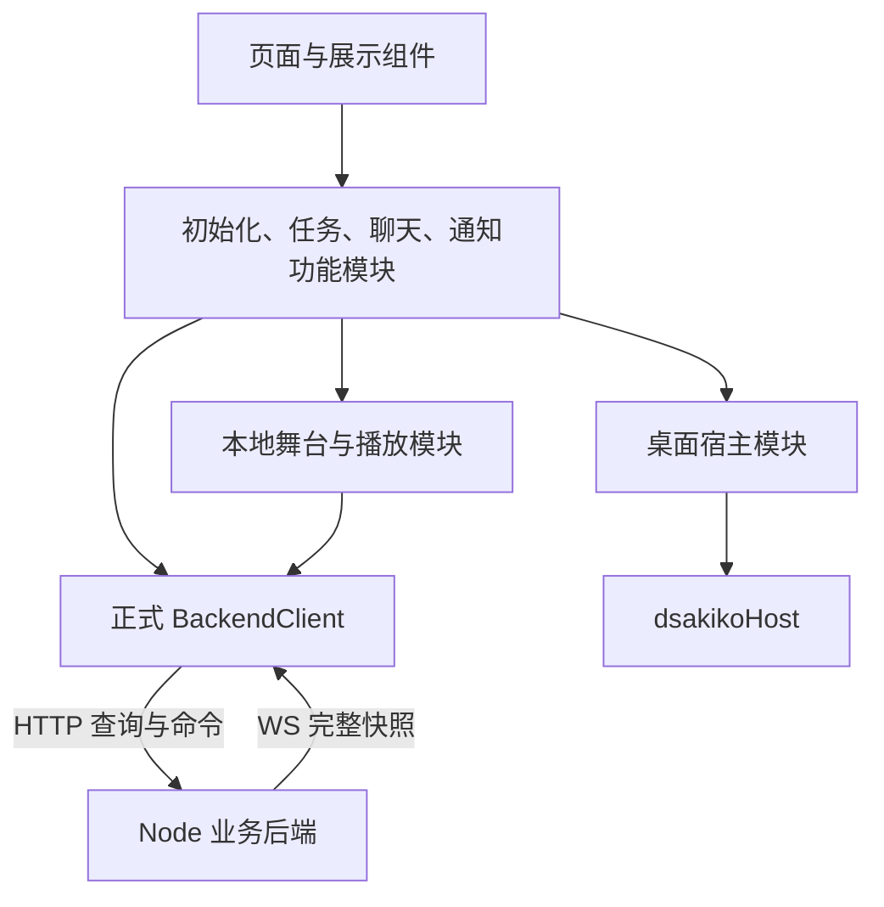
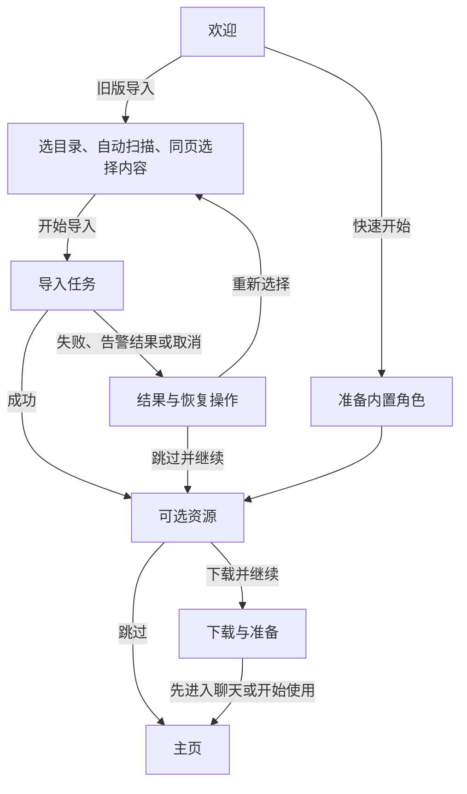

# Electron 前端实现设计

确认日期：2026-11-14。状态：产品范围与主要交互已确认，本文为实现依据，不代表功能已经完成。

本轮以现有 Figma 主页、欢迎页和资源导入设计为基础，替换未发布的 Electron demo，接通完整初始化流程和最小聊天主页，并补充轻量后端通知模块。交付用于内部开发 checkpoint，不作为面向用户的正式版本发布。

当前实现进度（2026-11-14）：按最新确认，已从欢迎页延伸至快速开始、可选资源、下载与准备完成。本次不实现旧数据导入和主页；ASR、跳过进入主页、先进入聊天和开始使用入口仍禁用，不调用 `onboarding.finish()`。启动读取持久阶段，自动继续中断的内置角色准备；已开始的下载按原任务身份恢复，退出后的暂停任务需手动继续。临时工具排除集合留到聊天接入阶段实现。

`features/setup/setup-flow.js` 管理初始化受理、目录与去重下载量、持久任务订阅、暂停／继续／重试及重新选择；`SetupPage` 共用通高暖纸布局、两阶段标识与固定底部，`ResourceSelection` 和 `DownloadProgress` 只组合展示。`CharacterPreview` 和 `welcome-preview.js` 管理模型加载与迟到结果，欢迎页、资源选择与下载页共用同一舞台实例，保留当前角色和鼠标追踪；换页只调整构图与右侧内容，不重载模型。复用正式 HTTP/WS 客户端、shadcn/ui Button／Checkbox／Progress；背景、Logo 来自 Figma，三角色头像使用 Python 版原图。开发运行仍为 `npm run dev`。

验证使用隔离数据目录。真实内置模型检查覆盖欢迎页与资源页追踪、跨页保留角色及模型／画布身份、角色切换、隐藏恢复、快速准备三个正式角色、刷新恢复资源选择，以及 1440×1024 和 1024×640 布局。下载端到端使用 512 KB 的受控资源源，经过真实后端下载、哈希校验、资源登记、HTTP/WS，验证暂停、跨后端重启恢复、失败重试与完成；不等同于完整模型下载或 TTS 推理验收。远端发布目录已核验 macOS arm64 的 gsv/asr 运行包存在，产品选项仍按实时后端检查结果决定可用性。

实际窗口测试修复了 Electron 文件页面 HTTP 票据与 WebSocket 的 Origin 差异，并覆盖普通网页不能交换票据及票据不能复用。常规 Vitest 30 个文件、231 项通过；Electron 端到端 3 个文件、3 项通过；构建、排除既有 `.local/**` 临时脚本后的全目录 ESLint 和 `git diff --check` 通过。模型完成下载不直接推断语音可用，`getFeatureState()` 仍是功能就绪依据。

## 1. 范围与设计依据

### 本轮实现

| 范围 | 内容 |
| --- | --- |
| 欢迎与初始化 | 三角色 Live2D 预览、快速开始、旧版目录选择与自动扫描、内容选择、导入进度、异常与取消后的处理 |
| 可选资源 | GPT-SoVITS 与角色语音选择、下载、安装、就绪状态、暂停、继续、重试及主页后台任务入口 |
| 单人聊天 | 角色与聊天导航、空白对话、首次发送、新建／删除聊天、文字发送／停止、聊天记录展开与收起 |
| 展示与播放 | Live2D 舞台、字幕、后端演出跟随、资源就绪后的角色语音播放、窗口隐藏与恢复 |
| 导入历史 | 单人历史阅读；小剧场历史只读查看与删除；角色缺失的历史阅读状态 |
| 通知 | 连接提示、角色语音就绪通知；跨重启保存、逐条关闭、去重；前端重叠卡片 |

首次交付覆盖上述全部内容，实现时拆成可运行的 checkpoint，不以只完成快速开始作为本轮终点。

### 暂不实现

- 浏览器前端访问、浏览器登录与引导。以后支持浏览器时，需在设置中手动开启；本轮不增加该设置，初始化期间不开放浏览器访问。
- 大模型连接设置、语音配置设置及完整设置页面。
- 附件导入、录音／识别输入、互动问答卡、消息编辑／重生成、历史语音播放与舞台回放、换装。
- 小剧场创建和续聊、深色主题、桌宠、主程序更新及安装器改造。

现有设计中的未接入入口保留但禁用。ASR 下载选项同样保留但禁用，不调用下载接口。UI 不增加“后续开放”“将在未来版本提供”等说明，也不在提示或悬浮说明中解释内部 checkpoint。真实业务错误、加载状态和缺少连接等提示仍正常显示。

### 文档与原型关系

- 本文确定当前 checkpoint 的范围、前端组织和新增 Notices 设计。与早期前端计划的范围冲突时，以本文为准。
- [初始化与资源准备设计](onboarding-and-resource-setup.md)继续定义导入兼容范围、资源选择、计划、持久任务、资源登记和安装规则。
- [前端与资源初步规划](frontend-and-resource-plan.md)保留整体方向；[后台下载与主页历史约定](../../docs/design/electron-background-voice-setup.md)保留导入兜底、语音启用及窗口行为。后者的“待实现”清单是历史记录，当前代码状态见下一节。
- [架构说明](architecture.md)、[数据目录与资源设计](data-directories-and-resources.md)继续约束依赖关系和资源所有权。
- 视觉依据为 Figma 文件 `D_Sakiko Design` 的 `Designs` 页。代表画板：欢迎页 `5046:2048`、主页 `5005:38511`／`5012:2957`、可选资源 `5054:2534`、后台任务 `5074:1329`、旧版导入 `5078:1853`／`5082:1998`、导入异常 `5086:1708`、语音就绪 `5086:2108`、角色缺失历史 `5090:2788`。

画板上的容量、速度、百分比、角色和聊天数量是示例。实现取后端实际数据。Figma 的多张差分可由同一个页面的不同状态表达，不按画板数量创建页面。具体颜色、字体、间距和组件变体在实现时读取 Figma 设计上下文，不凭截图估计。

## 2. 当前基础与迁移方式

| 能力 | 当前状态与处理方式 |
| --- | --- |
| `renderer/src/backend/client.js` | 已有正式 HTTP/WS 客户端、重连、完整快照观察和资源租约；继续使用，补齐新增接口的 JSDoc |
| `preload/index.js` | 已暴露 `dsakikoHost`，包括后端连接信息、目录选择及窗口可见性；作为桌面宿主能力使用 |
| Onboarding / ResourceSetup | 已有预览访问、连接扫描数量、导入异常后继续、任务快照、功能状态和语音自动启用基础；接入真实流程并验证 |
| `app/App.jsx`、`runtime/` | App 已装配快速初始化与资源任务，不再连接旧 demo；旧 runtime 尚未使用，后续聊天接入时继续整理 |
| `performance/interface.js` | 已有正式本地演出跟随与播放控制；与模型渲染、窗口生命周期重新装配 |
| 旧 `performance/runtime.js` / `surface.js` | 含旧 IPC 或资源访问假设；有用的渲染能力需核对后迁移，不能整体接回旧运行时 |
| `features/chat/input-sessions.js` | 目前是未实现的接口声明，且以 `chatId` 为输入身份；本轮只实现文字草稿所需部分，并支持无聊天的输入会话 |
| 通知 | 已实现 Notices、连接与语音就绪来源、持久关闭、恢复核对及 HTTP/WS 客户端；重叠卡片 UI 尚未接入 |
| 桌面关闭行为 | 已有 macOS 隐藏、Windows 关闭偏好及托盘能力；复用并核对新前端接入，不重复实现 |

旧 Electron demo 没有发布，不要求保留其页面、接口、数据格式或兼容开关。正式业务后端和有价值的底层能力按需复用。Python 旧版数据导入仍是本轮需求，不受 demo 清理影响。

## 3. 模块职责与依赖

沿用 React、JavaScript、中文 JSDoc、Tailwind 和 shadcn/ui。实例由应用入口统一装配，页面通过功能模块获取只读状态和具名操作。

### 主要模块

以下名称和目录是实现组织建议，不是要求预先创建全部文件。模块有实际职责时才拆分；不为每个后端方法增加同名转发层。

| 模块 | 持有与封装的内容 | 给调用方的主要能力 |
| --- | --- | --- |
| 应用装配 `app/` | 客户端、宿主、应用级功能实例、启动与销毁顺序 | 根据初始化状态显示引导或主页 |
| 桌面宿主 `host/` | `dsakikoHost` 调用、窗口可见性 | 获取连接、选择旧目录、观察窗口状态 |
| 初始化 `features/onboarding/` | 目录扫描、选择、计划与任务受理、阶段转换、迟到结果隔离 | 快速开始、选择目录、开始导入、取消、重新选择、继续、完成引导 |
| 资源任务 `features/setup/` | 任务恢复、按 ID 订阅、产品选项、任务状态到展示状态的转换 | 选择资源、启动、暂停、继续／重试、观察任务与功能就绪状态 |
| 聊天 `features/chat/` | 当前角色／聊天、列表、输入会话、发送意图、受理后的草稿交接 | 选择角色／聊天、新对话、编辑草稿、发送、停止、删除 |
| 通知展示 `features/notices/` | 后端通知快照、文案映射、展开状态 | 观察未关闭通知、关闭通知 |
| 本地演出 `performance/` | 模型、音频、字幕时钟、异步加载失效与释放 | 预览角色、跟随当前聊天、暂停／恢复本地输出 |
| 公共 UI `components/` | 基础控件、共享布局和有实际重复使用的业务展示 | 展示数据与操作回调 |

业务客户端不导入 React 或 Electron；页面不运行 Node、backend 或 preload 实现。桌面能力集中封装，但本轮只提供 Electron 实现，不编写浏览器适配器，也不在各页面散布运行环境分支。

### 状态归属

| 状态 | 权威所有者 | 前端保存方式与生命周期 |
| --- | --- | --- |
| 初始化路径与阶段 | 后端 Onboarding | 应用级只读快照；路由随后端确认的阶段变化 |
| 导入、下载、安装任务 | 后端 ResourceSetup | 应用级任务容器；页面离开不停止任务 |
| 角色、聊天、设置、功能可用性 | 正式业务后端 | 订阅或查询所得快照，不建立第二份可独立修改的业务数据 |
| 通知身份、顺序与关闭状态 | 后端 Notices | 应用级只读列表，重连恢复 |
| 当前角色／聊天、上次访问目标 | 前端导航模块 | 本地持久保存稳定 ID；恢复时核对目标仍存在 |
| 未发送文字和发送意图 | 前端输入模块 | 仅本次运行内存；切页保留，应用退出后不恢复 |
| 选择目录后的扫描展示、勾选项、提交中状态 | 对应功能模块 | 临时状态；异步返回必须匹配当前操作身份 |
| 通知展开、任务面板展开、输入焦点 | 前端 UI | 局部状态，不写后端 |
| 模型实例、音频与字幕进度 | 本地演出模块 | 应用持有；目标切换、隐藏和退出按生命周期释放或暂停 |

快照容器沿用 `watchConversation` 的思路，通过 `useSyncExternalStore` 接 React。`getSnapshot()` 在没有变化时返回相同对象，不在读取时请求网络。Context 传递稳定模块实例；高频下载进度、输入文字和字幕分别订阅，避免所有页面随一个大 Context 重绘。

## 4. UI 复用与窗口布局

### shadcn/ui 与业务组合

| 层次 | 首批内容 | 接口约束 |
| --- | --- | --- |
| 基础控件 | Button、Checkbox、Input／Textarea、Progress、Dialog、Tooltip、Popover 等实际需要的控件 | 直接使用或按项目主题调整，不额外包装仅转发参数的控件 |
| 共享布局 | 引导页背景与暖纸内容区、Logo／标题、底部操作区、只读两阶段标识 | 使用内容插槽组合，布局不处理业务请求 |
| 任务展示 | 资源选择行、项目状态行、进度摘要、任务操作区 | 接收明确的展示数据和操作回调；导入计数与下载字节分别转换 |
| 通知卡片 | `SidebarNoticeCard` | `title`、正文插槽、`tone`、`icon`、操作区、可选 `onDismiss` |

通知卡片的 `tone` 只决定视觉表达。下载、连接和就绪等业务含义由调用方提供，不用一个不断膨胀的 `mode` 同时决定请求、文案、布局和自动关闭行为。导入进度页与下载进度页共享局部展示，保留各自页面组合，不建立万能任务页面。

### 尺寸与主题

- 以 Figma 1440×1024 画板校对主要视觉；最低目标为 1147×745 的等效桌面环境，以约 1024×640 的页面内容区域验证可操作性。
- 桌面尺寸、窗口外框与 renderer 内容尺寸分别计算。窗口初始化和最小尺寸需结合实际工作区、菜单栏、Dock 和标题栏校验，不能把整个桌面高度直接作为内容高度。
- 引导页中间内容滚动，底部操作保持可见；两阶段标识不随异常或重试增加步骤，不可点击跳步。
- 宽窗口聊天记录与舞台并列；窄窗口记录面板覆盖舞台，保留输入区。具体断点由区域所需宽度验证，不按设备型号判断。
- 展开记录改变布局，不重建舞台实例或重新加载模型。舞台悬浮工具与输入框避让，保持在舞台内。
- 首版固定浅色，不跟随系统切换深色。主题变量集中管理，后续深色设计完成后再补充。
- 不可用入口实际禁用，避免仍响应键盘或点击；不附加未来版本说明。基本焦点、键盘操作、标签和对比度随控件实现。

## 5. 初始化与资源任务

### 页面状态

后端阶段为 `welcome`、`preparing`、`importing`、`optional-resources`、`complete`。前端在阶段内细分“未选目录、扫描中、可选内容、请求中、任务结果”等展示状态，不把每张画板写成独立业务阶段。

### 欢迎与快速开始

1. 读取 `onboarding.getState()` 决定恢复入口；未完成初始化时显示相应引导阶段。
2. 欢迎页通过 `getBuiltinPreview()` 获取受控临时模型 URL。首次默认白祥，欢迎页选中的角色在本次引导的资源选择和下载页面继续展示，不强制切回白祥；角色切换只影响预览，正式祥子默认形态仍沿用内置角色配置。
3. 鼠标追踪在欢迎页体验后保留，并延续到资源选择和下载页；不因此改变尚未实现的聊天舞台行为。预览加载失败显示失败与重试状态，快速开始和导入仍可用。
4. 快速开始调用 `onboarding.begin({ path: 'quick' })`，完成角色准备后进入可选资源页，不为自动准备增加必须停留的操作页。

### 旧版导入

1. `host.selectLegacyDirectory()` 返回 `{ sourceId, name }`；取消系统选择器不改变已有有效选择。
2. 自动调用 `setup.scanLegacy(sourceId)`；目录与内容选择是同一页。更换目录使旧扫描与计划结果失效，迟到结果不得覆盖新选择。
3. 根据扫描摘要展示角色、聊天、连接和 GSV 四类内容。保留“开始导入”文案，扫描未完成、无可导入项或请求中时禁用。
4. 点击开始后创建计划，再调用 `onboarding.begin({ path: 'legacy', planId })`。计划生成包含来源、空间和复用检查；页面不自己估计硬链接结果，不额外增加已否决的磁盘占用展示。
5. 订阅实际任务；逐项结果、告警和部分成功依据后端快照展示。保留已确认的结果汇总与进度条形式，不把部分成功伪装为完整成功。
6. 完整成功后调用 `prepareOptionalResources()`；失败或存在需确认的结果时保留结果页，由用户重试或“跳过并继续”。后者调用 `skipLegacyImport()`，由后端判断已有持久结果及零提交时的快速开始兜底。
7. “取消导入”先确认停止剩余内容、保留已导入结果。等待后端在安全节点取消，随后停留结果页；“重新选择导入内容”回到目录／扫描选择，“跳过并继续”进入可选资源。
8. 已取消任务不能直接恢复，重新导入需重新扫描并生成计划；失败／暂停任务按后端可恢复条件处理。重复导入继续使用来源去重，不覆盖已有用户修改。

只在首次提交前允许返回欢迎页或更换目录。进入可选资源阶段后移除“上一步”，不把已提交数据当作可撤销的表单状态。应用重启后，尚未开始的临时扫描选择可重新进行；已有持久任务恢复到相应状态，由用户继续。

### 可选资源与后台任务

- 初始不勾选。ASR 选项禁用；可用的角色语音允许直接勾选，并自动选中尚未准备的 GPT-SoVITS 基础资源。取消角色语音时保留基础资源选择，取消基础资源时同时取消依赖它的角色语音。已完整准备的资源复用，缺少运行环境时由后端补齐计划。
- 用 `getCatalog({ selection })` 的去重下载量展示选择结果；大小未知时不把已知部分冒充总大小。未发布的运行包按真实不可用原因禁用，不伪造就绪。
- 点击“下载并继续”后 `createPlan({ kind: 'download', ... })`，再 `setup.start(plan.id)`。本轮不增加新的资源配置页或平台运行包发布工作。
- 下载、校验、安装、验证和启用分别展示。下载 100% 不代表语音可用；速度／预计时间不存在时不编造数字，安装阶段不继续显示下载速度。
- 下载页和主页侧栏共享同一个应用级任务容器。首版不增加多任务调度 UI；遵守后端一次运行一个准备任务的约束，发现已有任务时先恢复其状态。
- “先进入聊天”调用 `onboarding.finish()`，不取消或暂停任务。任务失败也不把初始化退回未完成。
- 暂停／继续／重试是显式操作；等待安全节点期间显示操作中并避免重复提交。退出后恢复持久任务，用户手动继续。
- 任务状态变化后核对 `getFeatureState()`；角色、设置变化和重连后也刷新相关可用性。前端不直接把全局语音开关设为开启。
- 后端按角色形态、环境、基础模型和用户偏好判断语音，从下一轮生效，不改变当前轮，不补生成或补播历史。ASR 下载入口的禁用不改变后端原有识别能力。

## 6. 主页、输入与舞台生命周期

### 导航与历史

- 第一次进入主页显示祥子的空白对话，不自动打开导入历史；异常情况下目标角色不存在时选择可用角色，没有角色时显示可恢复的空状态。
- 后续启动恢复上次选择。聊天不存在时回到对应角色空白对话；角色也不存在时选择可用角色。使用稳定 ID，不按同名角色猜测关联。
- 点击已有聊天的角色进入上次访问的聊天；点击“新对话”或删除当前聊天后回到同角色空白对话，不自动跳到另一段历史。
- 聊天记录默认收起；阅读旧记录不强制滚到底部，用新消息入口回到最新。历史内容来自对话投影，不另存一份可编辑历史。
- 导入的小剧场允许列表、阅读、删除，创建与续聊禁用；历史语音播放和回放同样禁用。
- `participantIssue` 对应的记录归入各自页签的“角色缺失的对话”分组，显示只读面板及原因；角色没有模型不等于角色缺失，不阻止文字聊天。

### 文字输入会话

输入会话身份独立于 `chatId`，目标可为“角色的待创建对话”或已有聊天。空白角色界面可以编辑草稿，不预先创建空聊天。

1. 用户编辑同步写入所属输入会话，不通过异步旧快照整份覆盖。
2. 发送时冻结提交内容、目标、选项及稳定业务 `requestId`。内容未改变且上次结果不确定时重试同一发送意图。
3. 无聊天时调用 `createChatWithTurn(chatOptions, submission, { requestId })`；已有聊天调用 `createTurn()`。
4. 后端确认受理后，把输入会话关联到返回的聊天身份，更新列表；仅清理已确认发送且未被继续编辑的内容。
5. 受理前失败保留草稿；受理后生成失败保留聊天和失败轮次，不能伪装成未发送并重复创建。
6. 切换角色或聊天后，旧发送结果只更新原会话，不覆盖当前草稿或强制跳回旧目标。停止通过 `stopTurn` 明确请求后端，不以停止本地声音代替停止生成。

草稿仅在本次应用运行内保存。导航选择可持久化，不意味着草稿一并持久化。附件、录音及 InputSessions 声明中的其他能力不在本轮实现。

没有配置大模型连接时，输入框上方显示“当前没有配置大模型连接，无法发送消息”，右侧保留禁用的“前往配置”按钮。允许编辑草稿，发送禁用。配置存在但实际调用失败时显示真实调用问题，不把所有网络或鉴权失败都归为未配置。

### 舞台与桌面生命周期

- 欢迎预览和聊天舞台共享模型加载、缩放、渲染和释放能力；欢迎预览不创建聊天或演出任务。
- 本地播放跟随后端演出锚点，字幕随本地播放推进；聊天记录可以先于舞台更新。两个进度分别持有。
- 展开记录或改变布局只重新计算尺寸；模型目标不变时不重复加载。切换目标后，旧模型／音频异步回调失效并释放资源。
- 切换聊天停止旧聊天的本地输出；离开页面、隐藏或最小化暂停本地播放，恢复后跟随最新状态，不补播遗漏内容。单纯失去焦点不暂停。
- 无模型或模型加载失败仍保留背景、角色信息和字幕；不修改角色持久模型选择。
- macOS 关窗隐藏，Dock 恢复；Windows 沿用首次关闭偏好与托盘行为；显式退出才关闭后端和子进程。设置页未接入时，现有宿主提示中“可到设置修改”的承诺也需在文案检查中处理。
- 应用销毁统一释放订阅、音频、模型和资源访问租约；普通组件卸载不销毁全部草稿，不停止后端任务。

## 7. HTTP、快照与错误处理

启动使用 `dsakikoHost.getBackendConnection()` 创建正式 BackendClient。业务继续经 `/api/v1/call/<namespace>/<method>` 与 WS 传输，preload 仅提供桌面能力。复用现有鉴权、资源临时 URL 和租约；不公开绝对路径、任意下载 URL 或安装命令。

- 查询和命令经 HTTP；订阅交付完整快照。先建立权威观察后，额外查询结果不能覆盖更晚的快照；无版本的查询使用操作代次隔离迟到结果。
- 使用现有客户端的重连和运行身份／版本判断，不在各页面重新实现 WebSocket。
- 重连只恢复订阅与重新核对状态，不自动重放写命令。命令结果不确定时由功能模块保持原传输身份；聊天发送同时保持稳定业务 `requestId`。
- `AbortSignal` 取消等待不等于取消后端任务。控制任务、停止轮次必须调用相应业务命令。
- 角色变化优先使用现有订阅；无列表订阅的聊天摘要在创建、删除、导入提交及重连后刷新，当前聊天快照变化也更新相关摘要。刷新规则集中在功能模块。
- 连接断开、操作被拒绝、任务失败分别展示。保留 `Problem.code` 和 `retryable`，不解析错误文案来决定业务操作。
- 断线时可以继续编辑草稿，但阻止无法确认的重复写操作；旧快照可继续展示并标明连接状态，不把断线视为任务终止。
- 后端具备但本轮 UI 不消费的交互能力需在接入检查中核对；不能因互动卡暂缓而让聊天无提示地停在等待用户回答的状态。若需要变更工具可用性，单独明确最小处理方案，不据此自动扩大互动卡实现范围。

## 8. 轻量后端 Notices

### 职责与接口

已实现 `backend/notices/`，由核心后端装配，数据保存在应用数据目录的 `notices.json`。沿用现有 JSON 原子写入、串行队列和快照发布基础，不引入消息中间件或数据库。

| 接口 | 调用方 | 语义 |
| --- | --- | --- |
| `notices.list()` | 前端 | 返回按产生顺序排列的未关闭通知快照 |
| `notices.dismiss(id)` | 前端 | 持久关闭指定通知；重复关闭无副作用 |
| WS `topic: 'notices'` | 前端客户端 | 首次订阅和重连均交付完整通知列表 |
| 内部幂等登记与核对入口 | Onboarding、ResourceSetup 或核心装配 | 从持久业务结果产生、刷新或使通知失效；不向前端开放任意通知发布 |

`API_METHODS`、服务端 WS 路由、BackendClient 类型与便捷订阅同步补充。公开快照遵守现有运行身份与观察版本约定，读取不能把旧版本通知列表覆盖到新版本上。

### 记录与去重

最小记录包括稳定 `id`／来源键、通知 `kind`、产生时间与稳定排序号、关联角色／任务身份、必要业务载荷，以及关闭或失效状态。前端接收类型化业务数据，自己映射标题、正文、图标和动作；后端不保存 JSX、HTML 或样式。

- 首版覆盖首次连接提示和角色语音就绪两类。下载过程继续用任务快照，不把每个百分比保存成通知。
- 首次连接提示有唯一的初始化来源身份；语音就绪通知关联具体任务、角色及其就绪里程碑。同一次任务重试或重启核对使用同一来源键。
- 收到重复业务结果时不重复入队、不改变已有排序、不恢复已关闭通知。角色形态的就绪情况仍按后端能力判断，不因某一形态就绪声称所有形态可用。
- 未关闭记录跨重启保留。关闭后 UI 不提供历史，但保留必要的来源去重／确认记录；不能删除全部证据后在下一次任务扫描中重新生成。
- 业务持久提交与通知登记是两个步骤：登记必须可幂等补做。启动和资源任务恢复时核对持久业务结果，补齐“业务已完成、通知尚未登记”的窗口，不能只依赖进程内事件。
- 资源就绪的通知来源证据应在任务持久记录中可恢复；不能只靠内存中的一次 `ready: false → true`。通知写入失败不得把已安装资源回滚或把任务误报为业务失败，应保留可重试的通知登记证据。
- 新登记通知追加到队尾；已有通知的顺序不因重连或内容刷新改变。并发关闭与核对通过串行持久更新避免互相覆盖。
- 通知说明结合当前业务状态：用户后来关闭语音时，改为资源可用说明，不能继续声称已开启；角色被删除或资源不再可用时，核对并更新／使相关通知失效，不保留错误的可用性承诺。

Onboarding 的 `noticeAcknowledged` 和 `acknowledgeNotice()` 已移除，确认状态统一由 Notices 持有。连接本身是否配置仍由业务状态判断；关闭连接通知不移除发送框上的缺连接提示。未发布 demo 无需保留旧确认接口兼容层；旧确认字段不再参与公开契约或后续写入，内部开发数据可能重新出现一次通知。

### 后端接入与当前验证

公开快照为 `{ runtimeId, revision, notices }`。每条通知包含 `id`、`kind`、`createdAt`、`order` 和 `data`；来源键、关闭记录和文件位置不对前端公开。`connection` 的数据为 `connectionState`；`voice-ready` 的数据包含任务、角色、当前就绪形态和默认语音启用状态。启用状态不覆盖具体聊天的设置，UI 根据这些业务数据生成文案。

初始化完成后，缺少连接或快速开始仍使用内置连接时产生连接通知。下载任务为每个角色保存就绪里程碑，安装登记保存任务身份；启动时能补齐安装已提交但任务检查点尚未保存的窗口。未执行计划、取消后未登记的任务不产生就绪通知。同一任务与角色保持一个通知身份，新增就绪形态更新载荷。

核心装配在启动、业务来源改变和周期维护时核对来源，查询及首次订阅也会核对。读取来源失败不会清空历史；关闭已知通知不依赖资源扫描成功。通知文件写入失败由维护机制重试，不回滚业务结果；持久写入成功后才发布新快照。

2026-11-14：完整 Vitest 回归 27 个文件、219 项通过；构建和 Electron 宿主冒烟通过。宿主测试同步了现有 preload 方法清单，并加入构建后通知查询验证。强化启动恢复测试后，通知模块 11 项再次通过。本次文件 ESLint 通过；全目录 ESLint 的 4 项报错来自 `.local/builtin-compression-benchmark/measure.mjs` 临时脚本，排除 `.local/**` 后全目录检查通过。新增验证覆盖关闭持久化、顺序与去重、来源失效、并发核对、通知写入故障、任务恢复和真实 HTTP/WS 通知交付。资源安装和语音就绪判定在部分测试中使用受控替身，尚未进行真实下载、TTS 推理和新通知 UI 验收。

### 前端展示

- 折叠显示最旧的未关闭通知，多条时后方露出卡片形成堆叠，不显示数量。
- 点击堆叠的独立展开区域，向上展开为旧到新的列表；操作按钮与展开区域分离，避免点击“知道了”同时展开。
- 新通知追加下方，不抢占当前卡片、不自动滚到底部。允许列表增高时整体向上移动，到最大高度后内部滚动；不要求屏幕位置绝对固定。
- 点击外部或收起入口只折叠；关闭图标和“知道了”等效，才调用 `dismiss`。关闭后显示下一条，全部关闭则隐藏通知区。
- 不定时消失、不轮播，不增加历史通知页、搜索、筛选或系统通知。
- 下载任务入口独立保留，下载详情按需展开。通知关闭不能影响任务；小窗口中限制展开区域高度，避免遮住所有导航和底部设置入口。
- 关闭请求失败时保留／恢复该卡片并允许重试，不能把仅前端移除当作已持久关闭。

## 9. 接入顺序与验收

| Checkpoint | 实现内容 | 通过条件 |
| --- | --- | --- |
| 1. 应用基础与快速开始 | 新入口、桌面连接、shadcn/ui 主题与布局、真实预览、快速开始、可选资源跳过 | 从干净测试数据目录进入新主页；预览失败仍可继续；小窗口操作可达 |
| 2. 最小聊天与演出 | 导航、空白输入会话、首次发送、记录、删除、舞台跟随 | 双击／重试不重复建聊天，迟到结果不覆盖新草稿，展开记录不重载模型，切换和隐藏不串音 |
| 3. 旧版导入 | 自动扫描、四类选择、计划、进度、结果、取消与重试、只读历史 | 更换目录隔离旧结果；部分成功保留；取消后可重新规划或继续；小剧场与角色缺失历史可阅读／删除 |
| 4. 下载与后台任务 | 资源选择、真实进度、暂停／恢复／重试、进入主页后观察、按角色语音生效 | 页面切换不影响任务；100% 下载不伪装就绪；退出重启后手动继续；下一轮生效且不补播历史 |
| 5. 持久通知与完整流程 | Notices、连接提示迁移、语音通知、重叠列表、恢复核对 | 未关闭通知重启后存在，已关闭不重发；重试不重复；业务成功与通知写入之间中断可恢复；新通知不抢占 |

各 checkpoint 都是内部实现顺序，不是改变首轮总范围。Notices 的接口设计及后端接入可在下载 UI 完成前先实现，不要求阶段机械串行。

验证以模块 Interface 为主要测试面：输入会话验证异步受理与草稿归属，任务模块验证离页／恢复，Notices 验证持久化、去重、故障恢复和并发关闭。展示组件使用少量代表状态校对 Figma，不为每个静态包装组件编写镜像测试。

端到端使用隔离应用数据、资源库和缓存，不直接导入用户的日常数据目录。核对首次初始化、重复启动、断线重连、后台下载、取消导入、中文／空格路径、无连接、无模型、资源失败和最小窗口。资源就绪后的真实 TTS 另做实际调用验收；mock 测试或文件存在不能代替真实语音验证。

实现中执行相关 Vitest、ESLint、构建和宿主冒烟检查；真实平台运行包、签名包与安装器验收仍按对应发布文档执行，不把内部 checkpoint 当作完成正式发布验收。

## 10. 编码约束与文档维护

- 核心展示数据、输入会话、任务与通知快照使用完整中文 JSDoc `@typedef`；关键导出函数说明参数、返回值和时序约束。
- 复杂操作抽成具名 handler／功能方法，不在 JSX 中嵌入多行业务判断，避免嵌套三元和过长链式处理。
- 注释解释请求身份、生命周期、资源所有权和为何保留某种行为，不复述代码字面含义。
- 首次实现不引入泛化插件系统、通用通知中心、全能任务页面或新的状态管理库；实际重复出现的能力再集中封装。
- 技术文件拆分可随实现调整，但不得改变本文已确认的产品范围。新增产品能力或与已确认行为冲突时再讨论。
- 实现完成后更新各能力的当前状态和验证证据，并同步架构文档中已失效的旧 demo 描述。本文中的拟议目录与接口不能在实现前被引用为已存在能力。
